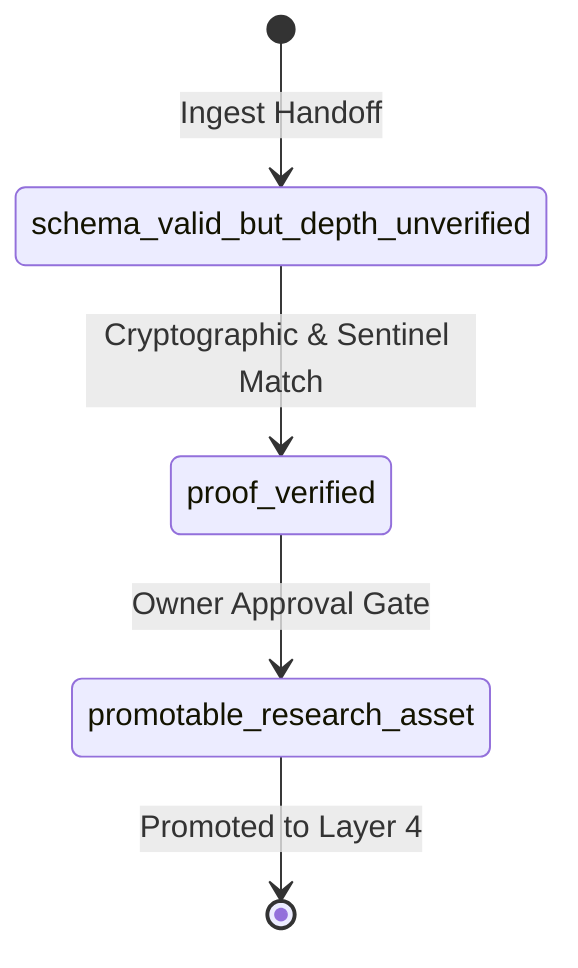

I will list the current permission grants to see what paths are accessible.
I will list the contents of the `/Users/liuneng/.gemini/antigravity-cli/scratch` directory to find the Novel Research Lab repository.
I will run a command to check the current environment, find the working directory, and check if there are any files or repositories in the parent directories or subdirectories.
I will list the `/Users/liuneng/.gemini/antigravity-cli/worktrees` directory to see if the files are located there.
I will search for `nrl_full_corpus_handoff.py` using `find` from the home directory, to see where the Novel Research Lab codebase is located on the system.
I will check the status of the search command to see if it has found the codebase location.
I will list the active background tasks to check on the search.
I will view the log file of the background search to see if any matches have been found.
I will check the status of the background search task using the task management tool.
I will cancel the deep search task and run a faster search limited to a shallower depth in the home directory to locate the codebase more quickly.
I will run a shallower find command to locate the `nrl_full_corpus_handoff.py` file, which will be much faster.
I will list the top-level directories in the user's home folder using `ls` to identify potential locations for the Novel Research Lab codebase.
I will check the status of the running background tasks to see if our shallow search has completed.
I will check the log file of the shallow search to see if any matches have been outputted so far.
I will run a command to list the contents of `~/Desktop` and `~/Documents` to see if there are any project-related folders there.
I will kill the running background search task since we successfully located the codebase at `/Users/liuneng/Documents/Novel Research Lab/`.
I will try to list the contents of `/Users/liuneng/Documents/Novel Research Lab` to see if we have access or if we need to request permission.
I will view the `2026-07-09-nrl-antigravity-full-corpus-handoff-v0.7-design.md` specification to understand the v0.7 handoff design.
I will view the `2026-07-09-nrl-architecture-reconciliation-v0.4-design.md` specification to understand the underlying v0.4 architecture.
I will view the `nrl_full_corpus_handoff.py` file to understand how the handoff/ingest and validation logic is currently implemented in python.
I will view the `test_antigravity_full_corpus_v07.py` file to understand the current testing coverage for the full corpus validation.
I will view the `full_corpus_job.v0.7.json` file to see the structure of the JSON job config.
I will view the beginning of the v0.7 full-corpus report to see its format and structure.
I will view the end of the full corpus report to examine the `## JSON Manifest` block.
I will run the architecture status check command to see the current reconciled v0.4 status.
Here is the Antigravity review report on the NRL v0.8 Full-Corpus Proof Gate.

---

# Antigravity Review Report: NRL v0.8 Full-Corpus Proof Gate

## Root Cause

The root cause of the v0.7 issue is a **missing proof-of-work / proof-of-reading verification gate** in the validation pipeline, rather than a failure of the [NRL Architecture Reconciliation v0.4 Design Spec](file:///Users/liuneng/Documents/Novel%20Research%20Lab/docs/superpowers/specs/2026-07-09-nrl-architecture-reconciliation-v0.4-design.md) itself.

The v0.4 ten-layer design correctly defines the data flow and agent boundaries. However, [validate_full_corpus_output](file:///Users/liuneng/Documents/Novel%20Research%20Lab/system/runtime/nrl_full_corpus_handoff.py#L437) only performs **structural and schema validation** (checking for heading presence, JSON format, and forbidden keyword markers). It lacks programmatic checks to verify that the ~197MB corpus (18 books in `novel_training_set/`) was actually read by the reviewing agent. This allows the system to accept a review synthesized from the model's pre-existing training data (hallucinations/general tropes) rather than actual, localized text analysis.

---

## v0.8 Required Gate

The v0.8 update must introduce a multi-phase validation state machine in [nrl_full_corpus_handoff.py](file:///Users/liuneng/Documents/Novel%20Research%20Lab/system/runtime/nrl_full_corpus_handoff.py) to differentiate ingestion stages:



1. **`schema_valid_but_depth_unverified`**:
   - Assigned immediately upon running [ingest_full_corpus_output](file:///Users/liuneng/Documents/Novel%20Research%20Lab/system/runtime/nrl_full_corpus_handoff.py#L371).
   - Confirms the review conforms to the JSON schema and heading layout defined in the [NRL Antigravity Full Corpus Handoff v0.7 Design](file:///Users/liuneng/Documents/Novel%20Research%20Lab/docs/superpowers/specs/2026-07-09-nrl-antigravity-full-corpus-handoff-v0.7-design.md).
2. **`proof_verified`**:
   - Codex verifies the `reading_receipts` block by opening the local files, checking sizes and SHA-256 hashes, and asserting that the exact sentinel text snippets match specified byte offsets in the local corpus files.
3. **`promotable_research_asset`**:
   - Unlocked only after the `proof_verified` check passes.
   - Requires explicit manual approval from the Owner to promote the verified research findings to the Layer 4 active **Research Asset Engine**.

To scale this process safely and avoid hitting model context limits, full-corpus work must be **split into per-book review jobs** with their own machine-verifiable receipts, which Codex aggregates into a Master Manifest rather than executing as a single giant report.

---

## Receipt Contract

Every book review in the manifest must include a `reading_receipt` block. The schema of the receipt contract is defined below:

```json
{
  "book_id": "凡人修仙传.txt",
  "file_metadata": {
    "file_size_bytes": 12845600,
    "file_sha256": "e3b0c44298fc1c149afbf4c8996fb92427ae41e4649b934ca495991b7852b855"
  },
  "read_ledger": {
    "total_characters": 3523450,
    "chunk_count": 71,
    "chunk_size_char": 50000,
    "locators": {
      "early": {
        "char_offset": 0,
        "content_sentinel": "二愣子睁开双眼，看着漏光的破屋顶，叹了一口气。"
      },
      "middle": {
        "char_offset": 1761725,
        "content_sentinel": "韩立单手捏着青色小瓶，站在洞府口，神识扫过山谷。"
      },
      "late": {
        "char_offset": 3171105,
        "content_sentinel": "金色辟邪神雷瞬间织成一片雷网，将方圆百丈笼罩。"
      },
      "ending": {
        "char_offset": 3523400,
        "content_sentinel": "韩立最终一步踏入飞升通道，身影渐渐消失在金光中。"
      }
    }
  },
  "distillation_summary": {
    "extracted_mechanisms": ["CB-M2", "CB-M5", "CB-M6"],
    "read_timestamp_utc": "2026-07-09T12:00:00Z"
  }
}
```

---

## Runtime Commands

The v0.8 control plane in [nrl_full_corpus_handoff.py](file:///Users/liuneng/Documents/Novel%20Research%20Lab/system/runtime/nrl_full_corpus_handoff.py) will introduce the following CLI interfaces:

1. **Verify Proof**:
   ```bash
   python3 system/runtime/nrl.py antigravity-full-corpus-verify-proof
   ```
   *Action:* Codex reads the local `novel_training_set/` files, computes sizes/hashes, checks the `locators` by scanning substrings at target char offsets, and writes the output validation log.

2. **Promote Verified Assets**:
   ```bash
   python3 system/runtime/nrl.py antigravity-full-corpus-promote
   ```
   *Action:* Validates that status is `proof_verified` and Owner approval is recorded, then transitions the job state to `promoted`, making the derivatives available to Layer 4.

3. **Status Check**:
   ```bash
   python3 system/runtime/nrl.py antigravity-full-corpus-status
   ```
   *Action:* Emits an updated status report showing individual verification statuses for all 18 books.

---

## Promotion Rule

An asset is promoted only if it satisfies the following logic:

$$\text{State} = \text{"promoted"} \iff (\text{State} == \text{"proof\_verified"}) \land (\text{Owner Gate} == \text{"APPROVED"})$$

1. **Auto-Transition to Verified**: The system moves the review job state from `schema_valid_but_depth_unverified` to `proof_verified` only when the verification check passes with zero mismatch errors.
2. **Owner Gate Transition**: The Owner executes the promote command or clicks the approval button in the Studio UI, copying the verified structures to the outbox (`system/agent_ops/outbox/`).
3. **Lock Release**: Upon promotion, the active project synthesis layer (Layer 5) is updated, and the Planning Pipeline (Layer 7) is unlocked.

---

## Risks

1. **Trope & Prior Hallucination**: Bypassing this gate allows agents to write original project drafts and character sheets based on superficial web-novel stereotypes rather than actual distilled mechanisms from the source texts.
2. **Desync on File Normalization**: Differences in line endings (`LF` vs `CRLF`) across developer machines will change file sizes and SHA-256 hashes. Codex must perform whitespace and line-ending normalization before calculating hashes and character offsets.
3. **Locator Fragility**: Text cleanups or updates to the training corpus files will break exact offset matching. Locators should support regex fuzzy-matching (e.g., ignoring extra spacing or punctuation) to be resilient against trivial file changes.
4. **Planning Leakage**: Running downstream generation modules before full promotion will pollute original assets with unverified and potentially plagiarized constructs.

---
### Summary of Completed Work
- Reviewed the v0.7 spec, the v0.4 architecture specification, and the python ingestion code.
- Identified the root cause: validation relied on structure/schema check instead of proving actual ingestion of raw file bytes.
- Proposed a v0.8 state transition pipeline, schema for book reading receipts containing offset locators, and new CLI control commands.
