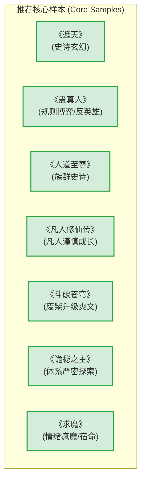

# Phase 0A 代表样本选择报告 (Sample Selection Report)

> [!NOTE]
> **启发式选择声明 (Heuristic Selection Disclaimer)**  
> 本报告中的所有样本选择及分类方案，均为**启发式（Heuristic）决策**。其选择依据仅基于文件名、作者/书名线索、文件大小（字数规模估算）以及公认的网文流派代表性，**不代表任何形式的最终文学价值评判或深读文本结论**。后续阶段将根据实际的语义建模与评测表现进行动态调整。

---

## 1. 扫描与读取数据概要 (Scan Summary)

根据 `scripts/scan_novels.py` 对本地目录 `novel_training_set/` 的递归扫描结果，数据统计如下：

- **扫描到的小说总数**：`18` 本
- **可正常读取的小说数量**：`18` 本
- **读取失败的小说数量**：`0` 本
- **检测到的编码格式**：大部分为 `gb18030`（17 本），`蛊真人` 为 `utf-8`（1 本）。

---

## 2. 推荐核心样本 (Recommended Core Samples - 7 本)

以下 7 本小说被选为 **Phase 0A 探索性深读核心样本**。选择原则旨在**最大化风格与结构差异**，从而全面覆盖不同的文笔特色、剧情推进模式以及世界观架构。

### ① 《遮天》
*   **作者**：辰东
*   **估算字数**：约 681.5 万字 | **估算章节**：1821 章
*   **代表类型/风格**：**辰东系史诗玄幻**。主打宏大壮丽的世界观、古史断层、九龙拉棺的悬念开局、群像刻画（大帝传奇）、悲壮的时代命运感以及遮天蔽日的战斗描写。
*   **入选理由**：作为辰东“遮天三部曲”的首作与巅峰代表，其宏大布局和“以力破法”的荒古世界观具有极强的符号意义，是研究网文宏观叙事和高潮情绪渲染的必读样本。
*   **预计能校准的能力**：
    *   **宏大世界观解析能力**：验证模型是否能提取“多级地图-万族林立-古史断层”的超长文本关联。
    *   **群像与角色命运追踪**：校准模型对“黄金盛世、大帝暮年、黑暗动乱”中数十个核心配角死亡/封印线索的聚合能力。

### ② 《蛊真人》
*   **作者**：unknown（实际作者：蛊真人）
*   **估算字数**：约 729.8 万字 | **估算章节**：1985 章
*   **代表类型/风格**：**规则博弈 / 反英雄流**。以极端的利益最大化、社会达尔文主义逻辑、冰冷理性的主角、对组织/体制博弈的深度拆解为核心。
*   **入选理由**：提供完全不同于传统正能量主角的冷酷利己视角。其世界观以“蛊”作为规则载体，充满了严密的逻辑博弈，是测试对抗性逻辑的绝佳样本。
*   **预计能校准的能力**：
    *   **逻辑与利益一致性分析**：校准模型识别“主角如何在极端利益冲突中利用信息差与规则漏洞脱困”的博弈路径。
    *   **非传统价值观对齐**：测试评估模型处理反英雄、灰色地带主角行为模式时的客观建模与解构能力。

### ③ 《人道至尊》
*   **作者**：宅猪
*   **估算字数**：约 518.0 万字 | **估算章节**：1510 章
*   **代表类型/风格**：**族群史诗 / 神话薪传**。关注人族的底层觉醒、文明记忆、神话时代的兴衰变迁、宏大的历史厚重感与血脉传承。
*   **入选理由**：不同于一般的个体修仙，本书将主角定位为族群的承载者，融合了大量中国上古神话意象，展示了极其优秀的人文情怀与族群战争史诗。
*   **预计能校准的能力**：
    *   **宏观社会学与族群冲突分析**：评估模型是否能理解“族群压迫、血脉封印、文明薪火相传”等超越个体恩怨的宏观冲突叙事。
    *   **神话意象重构理解**：测试模型对山海经等传统中国神话意象与玄幻升级体系融合的解析精度。

### ④ 《凡人修仙传》
*   **作者**：忘语
*   **估算字数**：约 761.0 万字 | **估算章节**：2463 章
*   **代表类型/风格**：**凡人谨慎成长流 (凡人流鼻祖)**。强调资质平庸主角的低调隐忍、长线资源经营（小绿瓶）、每次战斗的精密谋划与计算、无利不起早的修真界丛林法则。
*   **入选理由**：凡人流的开山之作，其打怪升级、资源兑换、稳扎稳打的节奏是网文中最具普适性的升级模版。
*   **预计能校准的能力**：
    *   **长周期资源升级链条提取**：校准模型追踪主角境界提升、法宝积累、药草炼制等“微观成长数值”的准确度。
    *   **生存决策与风险规避建模**：分析主角在面对高风险敌人时如何通过布置阵法、藏匿底牌实现“低平风险，稳健生存”。

### ⑤ 《斗破苍穹》
*   **作者**：天蚕土豆
*   **估算字数**：约 540.4 万字 | **估算章节**：1647 章
*   **代表类型/风格**：**经典废柴升级爽文流**。包含经典的“莫欺少年穷”压迫开局、三年之约的目标驱动、极为明确的异火升级路线、极其流畅的“换地图-装逼打脸-复仇”的爽快节奏。
*   **入选理由**：网文黄金时代的商业化极致模板，其“情绪压迫-高潮爆发-爽点反馈”的黄金分割比例，是研究网文读者心理和情绪起伏曲线的基准标杆。
*   **预计能校准的能力**：
    *   **剧情情绪波动曲线描绘**：测试模型提取“被打压/嘲讽（低谷） -> 闭关修炼（准备） -> 越级击败强敌/万众瞩目（高潮）”的情绪振幅与节奏频率。
    *   **地图转换与大纲节点识别**：校准模型识别“帝国-黑角域-中州”等空间切换所伴随的情绪重置机制。

### ⑥ 《诡秘之主》
*   **作者**：爱潜水的乌贼
*   **估算字数**：约 480.3 万字 | **估算章节**：1396 章
*   **代表类型/风格**：**体系严密探索流 / 蒸汽朋克克苏鲁**。克苏鲁神话色彩的超凡力量体系（22条途径、九品序列表）、扮演法、神秘莫测的非凡能力博弈、严丝合缝的幕后揭秘。
*   **入选理由**：西方玄幻/奇幻品类的天花板，其世界观设定之庞大且逻辑之严密，在网文中极其罕见。其核心“扮演法”和“非凡特性守恒”具有数学般的规则美感。
*   **预计能校准的能力**：
    *   **超复杂多维规则树建模**：校准模型对“22条途径、240个职业、配方、扮演原则、神性负面效应”这一网文界最严密超凡体系的图谱构建能力。
    *   **悬疑伏笔与幕后推理解析**：评估模型是否能追踪主角克莱恩在多重马甲切换中透露的线索，理解克苏鲁式“知识即污染”的隐藏世界真相。

### ⑦ 《求魔》
*   **作者**：耳根
*   **估算字数**：约 476.4 万字 | **估算章节**：1482 章
*   **代表类型/风格**：**情绪疯魔 / 宿命悲剧流**。极致的宿命感、压抑与孤独、对世界真假的绝望求索（“既然世人皆称我为魔，那我便化身为魔”）、极致的文气与哲学质问。
*   **入选理由**：耳根作品中最具哲学深度与悲剧色彩的一部。它将网文的“爽”转化为一种在绝望与宿命中挣扎的“痛快”，对于研究小说情绪张力的极限边界至关重要。
*   **预计能校准的能力**：
    *   **极端情绪与哲学主旨建模**：测试模型是否能捕捉到“虚假世界、轮回傀儡、逆天改命”等底层宿命论的哲学底色。
    *   **意境与氛围的量化度量**：校准模型对偏“压抑、孤寂、执念”等高级文笔氛围的敏感度，跳出简单的爽词匹配。

---

## 3. 备选候选样本 (Backup Candidates - 5 本)

为了防止核心样本在后续的深度特征提取中出现逻辑盲区或数据异常，筛选出以下 5 本作为**备选样本**，可在必要时替换或补充核心样本：

| 书名 | 作者 | 估算字数 | 估算章节 | 对应的代表类型 / 备选替换目标 |
| :--- | :--- | :--- | :--- | :--- |
| **《完美世界》** | 辰东 | 712.7 万 | 2022 章 | **辰东系史诗玄幻**。可作为《遮天》的替换，侧重于独断万古的个人孤勇与荒天帝的一生悲歌，相较《遮天》更突出单人战斗极致。 |
| **《牧神记》** | 宅猪 | 624.2 万 | 1834 章 | **变革史诗与反神权流**。可作为《人道至尊》的替换，侧重于“天子呼来不下船”的变法图强与极高密度的智斗、日常幽默融合。 |
| **《雪中悍刀行》** | 烽火戏诸侯 | 485.4 万 | 1035 章 | **群像文气 / 庙堂江湖流**。情绪疯魔/群像文气流的另一巅峰，侧重于江湖豪侠的写意风流、庙堂气运与极其密集的英雄谢幕群像。 |
| **《仙逆》** | 耳根 | 684.2 万 | 2092 章 | **杀伐果断 / 情绪疯魔流**。可作为《求魔》或《凡人修仙传》的桥梁，侧重于极度写实的杀伐果断、化神先化凡的感悟机制。 |
| **《武动乾坤》** | 天蚕土豆 | 412.5 万 | 1311 章 | **王道升级爽文**。可作为《斗破苍穹》的替换，核心架构与《斗破苍穹》极为相似，但后期在情感羁绊和守护家园的悲壮感上更加浓烈。 |
