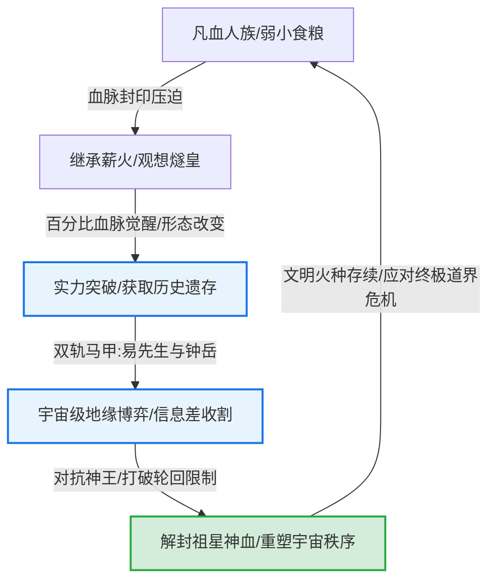
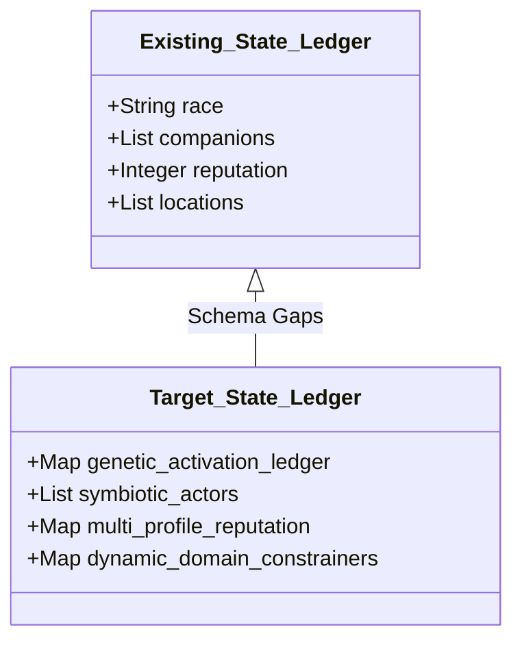

# 《人道至尊》小说结构与叙事架构深度解构报告

**项目阶段**：Phase 0A  
**定位**：小说研究实验室（Novel Research Lab）专用校准与标杆分析报告  
**分析对象**：《人道至尊》（作者：宅猪）  

---

> [!NOTE]
> **本报告由 Novel Research Lab 资深小说研究分析师生成**  
> 本报告基于对《人道至尊》骨架文本（[人道至尊_skeleton.txt](file:///Users/liuneng/Documents/Novel%20Research%20Lab/phase0A/skeletons/人道至尊_skeleton.txt)）的计算分析与结构建模，旨在从叙事工程学与系统演化论的视角，深度解构该作品在“人类命运”、“祖宗记忆”、“神话重构”、“种族觉醒”及“个体与集体绑定”等核心维度的成功要素，并针对实验室现有的 Book DNA、Narrative DNA 和 State Ledger 数据模型提出 Schema 修正建议。

---

## 1. 核心魅力 (Core Appeal)

从叙事工程与文学架构的角度来看，《人道至尊》的成功在于其将**传统网络文学的“升级爽感”与“宏大文明悲歌”进行了深度融合**。其核心魅力可以解构为以下四个维度：

*   **文明薪火相传的族群史诗与悲壮宿命感**：不同于常规修仙小说中“主角为求长生不择手段”的利己主义视角，本书的核心驱动力是“人族的绝境求生与文明复兴”。主角钟岳的成长被赋予了沉重的族群责任——人族并非天地灵长，而是被诸神万族当成祭牲和食粮的奴役种族。通过揭示人族实为陨落的至尊“伏羲神族”这一历史真相，将个人的升级路径与“文明薪火（薪火相传）”的传承深度绑定。历代先贤为延续族群而血战至死、甘愿化作历史尘埃的悲壮描写，赋予了全书极强的历史厚重感与道德合理性。
*   **古典神话的解构与星系级重构**：小说将中国上古神话（三皇五帝、山海经、雷泽、华胥、燧皇、女娲）进行了极具科幻感与玄幻色彩的系统化重构。神话人物被定义为统治宇宙不同纪元的太古神族，而神话遗迹（如大荒剑门、泰山、西昆仑、汤谷）则被重塑为大宇宙尺度下的空间坐标与法则节点。这种将传统文化符号“硬核化、规律化”的重构方式，创造了极具辨识度且带有浓厚民族文化共鸣的世界观架构。
*   **“战神真身-军师智囊”的智勇双轨博弈（易先生-钟岳）**：小说在中后期巧妙地引入了双重化身机制。主角本体“钟岳”作为伏羲叛逆，战力无双，在暗中构建抵抗势力“祖庭”；化身“易先生”则扮演算无遗策的“天下第一军师”，深潜入敌对阵营天庭（穆先天麾下）参与帝位争夺。这种“自己与自己博弈、自己给自己做局”的双轨叙事，既保留了热血战斗的张力，又极大拓展了宏观地缘政治与智力博弈的叙事维度。
*   **追求终极公平的“轮回重塑”宏大愿景**：小说在后期将冲突从简单的“物理占领/种族屠杀”升华为“天道法则的争夺”。主角不仅要击败压迫者，更要通过开辟“轮回第七区”和“大时空轮回”，打破太古神王对灵魂 and 生命秩序的垄断，为大宇宙万灵建立终极的法则公平。这一宏大愿景使小说的精神内核超越了狭隘的“血亲复仇”，达到了系统设计层面的“人道至尊”。

---

## 2. 读者成瘾机制 (Reader Addiction Mechanics)

《人道至尊》在叙事节奏上构建了一套精密的多层反馈与成瘾回路：



*   **“百分比基因解封”的成长增量反馈**：主角的升级不再是抽象的“等级/境界”数字跳动，而是“伏羲神血觉醒率（从0.1%到100%纯血）”的视觉化过程。每一次觉醒都伴随着生理形态的异化（长出蛇尾、龙鳞、龙角，睁开第三只神眼）以及遗传记忆数据库（先贤传承）的解封。这种**“肉身异化+数据库解密”的数值增长反馈**，极大地增强了读者的期待感。
*   **双重身份（马甲）带来的信息不对称溢价**：读者全程处于全知视角，看着“易先生”在帝朝群雄面前算无遗策、被穆先天倚为心腹，甚至替敌对势力排兵布阵，而其真实身份却是人人得而诛之的伏羲余孽。这种**高强度的戏剧张力与智商压制**，为读者提供了阻断数百万字的信息差爽点。
*   **“大富翁式”历史遗存的探秘与回收**：世界观中散落着历代伏羲天帝（如地纪时代的九代天帝、六十四任道尊）留下的“后手”与“帝陵”。主角通过“暗网”通道在大宇宙中四处考古，解锁先祖遗存。这种**“拼图式历史重构”与“宝藏回收”**的探索机制，为长线叙事提供了稳定的微观成就感。
*   **“集体危机-悲壮牺牲-终极逆袭”的情绪周期振幅**：小说的危机往往以“人族灭种”或“伏羲暴露”等宏观灾难形式出现（如祖星封禅、镇天关围剿）。在危机中，先贤配角（如风裳、风瘦竹、农皇）的悲壮牺牲将读者的压抑感拉到极限（情绪谷底），而主角随后的血脉爆发、地缘反击以及“封印天下神血”的决绝举动，则引导情绪在极短时间内完成超高强度的爆发与释怀。

---

## 3. 标志性特征 (Signature Features)

作为族群史诗的标杆作品，《人道至尊》提炼出了六个高度符号化的标志性叙事特征：

1.  **薪火与火纪宫燧皇图 (Xin Huo & Sui Huang Legacy)**：传承自太古火纪时代的火种实体，兼具“嘴碎的系统导师”、“世界观数据库”和“文明续存符号”三重属性，依靠吞食神火维持生命，是整部书叙事链条的起点。
2.  **人首蛇身与第三神眼 (Fuxi Morphological Iconography)**：伏羲神族的标准战斗形态。蛇尾代表盘古血脉的厚重，第三神眼代表天道法则的洞察力。每一次血脉提升都伴随着形态的向祖性进化。
3.  **易先生与战略化身 (Mister Yi & Persona Infiltration)**：主角分裂出的“智慧法相”化身，以羽扇纶巾的军师形象行走于紫薇星域，通过“智战”在万族霸主间纵横捭阖。
4.  **封印天下神血 (The Sealing of Divinity)**：主角在祖星泰山发动的封禅大祭，为了保护弱小人族不被诸神彻底灭绝，以大毅力将祖星所有神魔种族打落为“凡血”凡人。这是全书的第一个叙事高潮，也是主角“绑定族群利益”的终极体现。
5.  **六道轮回暗网 (The Six-Paths Dark Net)**：由前朝最强者伏旻道尊在大宇宙地狱轮回建立的单向传送通路网络，为主角在后期面对太古神王追杀时提供了合理的逻辑逃生路径与战略机动性。
6.  **伏旻道尊与万古悲鸣 (Daoist Fumin's Legacy)**：上一代天帝，地纪时代的最高峰，在寿元将尽、举世皆敌的绝境下为后世设下了无数后手，但最终依然英雄迟暮、悲惨谢幕。他的意志和后手是贯穿整部书的“因果主线”。

---

## 4. 标志性特征背后的深层叙事功能 (Deep Narrative Function of Signature Features)

这六大特征不仅是世界观设定，更是在长篇宏大叙事中用于攻克特定结构难题的“工程学工具”：

| 标志性特征 | 叙事工程学功能 | 解决的叙事痛点 |
| :--- | :--- | :--- |
| **薪火与观想图** | 作为可移动的“背景设定播放器”与“战力准星”。它不需要主角顿悟，而是通过薪火的“纠偏”实现战力合理进化。 | 避免了传统网文主角升级全靠“运气爆棚捡功法”的逻辑漏洞，使传承具有文明连续性。 |
| **人首蛇身与神眼** | 将“血统纯度（数值）”与“生物异化（视觉）”完美绑定，使每一次升级都具备强烈的视觉符号展示。 | 解决了中后期升级带来的“境界代号通胀（如元婴到化神）”导致的读者审美疲劳。 |
| **易先生与马甲** | 创造独立的“智斗/文斗图层”，允许主角在不暴露核心反叛身份的前提下，强行接入紫薇帝朝的政治权力核心。 | 解决了“反叛者主角由于阵营对立，无法参与主流大势力地缘政治博弈”的单调对立问题。 |
| **封印天下神血** | 实现局部战力生态的“硬着陆”重置，同时完成主角从“个体变强”到“族群守护者”的道德内核升华。 | 避免了主角升级后直接抛弃初始新手村（祖星）的通病，为后期“科技地球”的现代神话衔接打下钢钉。 |
| **六道轮回暗网** | 提供全宇宙尺度的“绝对防御与单向逃生阀”，为主角的宏观闪击战提供物理合理性。 | 解决了“主角弱小时面对宇宙级神王不合理追杀，只能依靠作者强开主角光环（降智反派）逃生”的机械叙事病。 |
| **伏旻道尊的后手** | 建立“前人栽树，后人乘凉”的跨时代复利因果。主角的成长是在“继承并激活先贤资产”。 | 解决了“主角个人机缘过于逆天，显得不符合大宇宙概率论”的突兀感，将其转化为文明复兴的必然因果。 |

---

## 5. 公共类型语汇 (Public Genre Vocabulary)

《人道至尊》对网络文学尤其是“神话仙侠/族群史诗”流派贡献了极具生命力的类型语汇：

*   **薪火相传 (Xin Huo Legacy)**：在玄幻网文中，特指一种超越肉身与灵魂、跨越纪元以某种执念或智能形态存续的文明文明记忆载体。
*   **凡血与神血封印 (Mortal Degeneracy & Bloodline Suppress)**：打破了“人类是猿猴进化/普通生物”的设定，将人族定义为“神血被重重诅咒、退化剥离后的凡血状态”，现已成为“血脉复苏流”的标准底层设定。
*   **双化身智斗 (Dual-Persona Espionage)**：特指主角分裂出两个完全对立的身份，左手打右手，在两大敌对阵营中同时担任核心高管的叙事套路。
*   **祖星 (Ancestral Star)**：特指所有超凡历史的起源地、大世之争的归宿（在本书中具象为被封印的地球），现已成为玄幻/科幻跨界网文中指代地球的公认语汇。
*   **轮回第七区 (The Seventh Samsara Zone)**：在经典的六道轮回（天、地、人、神、鬼、畜）之外，通过科学推演或世界观拓展，人为开辟的第七个维度（如“时空轮回/法则轮回”），用来重塑宇宙秩序。

---

## 6. 高识别度组合 (High Recognition Combos)

在IP衍生或创作借鉴时，以下三个高识别度元素组合是《人道至尊》的“ Narrative DNA”，必须捆绑使用以保证叙事风味的纯正：

```
组合 A (生物与文明符号组合)
┌────────────────────────────────────────────────────────┐
│  人首蛇身 (法相) + 第三神眼 (天瞳) + 薪火铜灯 (文明载体)  │
└────────────────────────────────────────────────────────┘
                          │ (触发)
                          ▼
             燧皇观想图 / 伏羲神血解封 (基因复苏)

组合 B (战略博弈与交通组合)
┌────────────────────────────────────────────────────────┐
│ 战神本体 (钟岳) + 天下第一军师 (易先生) + 千翼古船 (越界)│
└────────────────────────────────────────────────────────┘

组合 C (神话落地与地球回归)
┌────────────────────────────────────────────────────────┐
│  泰山封禅 (封印神血) + 现代科技地球 (凡血时代)           │
│  + 纪元终结解封 (万羽龙船飞临/神话复苏)                 │
└────────────────────────────────────────────────────────┘
```

*   **组合A（人首蛇身-神眼-铜灯-燧皇观想）**：这是视觉与精神的统一体。铜灯中的薪火引导钟岳观想燧皇，激发并重构其身体，逐步长出蛇尾、龙鳞和第三只眼。这是伏羲神族觉醒的标准视觉识别链条。
*   **组合B（钟岳-易先生-千翼古船-祖庭）**：战略机动与马甲渗透组合。易先生通过八卦推演和政客马甲在明处操盘帝争，钟岳本体在暗处利用千翼古船跨越空间壁垒建设祖庭，明暗双轨通过“信息差”实施对天庭和太古神王的双重欺骗。
*   **组合C（泰山封禅-凡血地球-龙船回归-水子安历史课）**：这是神话降维落地的核心闭环。小说在结尾将宏大的玄幻宇宙收拢于读者熟悉的“现代地球”，通过“水老师（水子安）在课堂上拖堂讲泰皇神话”这一日常温馨场景，引出千翼龙船跨越虚空解封地球的终极高潮，完成了从“远古神话 -> 宇宙史诗 -> 现代地球 -> 神话复苏”的完美因果闭环。

---

## 7. 可学习机制 (Learnable Mechanisms)

对于小说研究实验室而言，我们可以从《人道至尊》中提炼并复制以下三套叙事工程机制：

1.  **“生物形态解封（Morphological Unsealing）”升级替代机制**：
    *   **机制设计**：取消单纯的“炼气-筑基-金丹”式的数值升级，或者将其作为背景，而将**“生理器官的返祖与解密”**作为核心晋升事件。主角的实力提升伴随着“蛇尾长度增加”、“龙骨关节爆响（三十三重洞天化作脊梁）”、“第三只神眼的开合度”。
    *   **效果**：为读者提供强烈的生理变化画面感，每一次升级都是一次“进化”，从而在感官上产生比单纯数值翻倍更高级的爽点。
2.  **“敌对阵营双轨深潜（Dual-Track Deep Infiltration）”博弈机制**：
    *   **机制设计**：设计两个完全独立的声望账本（Reputation Ledger）。本体承担绝对的仇恨与杀伐（反叛军领袖），化身承担极高的信任与政治资产（帝国国师）。化身通过替敌人“出谋划策”来制造局部冲突，暗中消耗敌方战力，同时将资源输送给本体。
    *   **效果**：制造极致的戏剧讽刺。当敌方大帝对主角的化身推心置腹、甚至感叹“得易先生得天下”时，读者获得的情绪价值是非线性的。
3.  **“跨纪元先贤资产承接（Intergenerational Legacy Reclamation）”叙事曲线**：
    *   **机制设计**：不让主角成为“平地起高楼”的开创者，而是将其设计为“伟大废墟的唯一继承人”。世界观中必须存在一个已经覆灭但曾经达到巅峰的文明（地纪时代）。主角的每一次冒险，都是去“重启”先祖的战争机器、解封先祖的功法、或者唤醒先祖的执念。
    *   **效果**：将孤独的主角升级路，变成了一场“有千军万马的先烈英灵在背后支撑”的集体战役，极易引起读者的情感共鸣与热泪盈眶。

---

## 8. 必须避免的低级缝合风险 (Avoiding Low-Level Copycat Risks)

在尝试复制或缝合《人道至尊》的结构时，必须警惕以下容易导致作品失去灵魂的低级错误：

*   **“神话贴纸化”而不做物理法则融合**：低级缝合往往直接借用“伏羲”、“燧皇”、“女娲”这些名字，但仅将其作为普通NPC的代号，未曾像《人道至尊》一样，将“燧皇代表火纪元（火与精神的发展）”、“伏羲人首蛇身代表盘古阴阳与雷泽华胥基因融合”等神话细节，解构成底层功法逻辑（如火纪宫观想图的宏大观想细节）。这种生硬贴签只会让小说显得低俗且缺乏底蕴。
*   **马甲“精神分裂与强行降智”**：如果将“易先生”的智战写成“全靠周围反派主动降智、智商降为负数来强行衬托易先生”，或者主角本体与化身之间缺乏核心逻辑关联，导致读者感觉在看两个毫不相干的人，就会彻底破坏双轨博弈的张力。
*   **“血脉等级压制”沦为生硬的社会达尔文主义**：若将“伏羲神血”简化为纯粹的“高贵血脉对低贱血脉的绝对压制”，而没有描写“血脉背后的责任、人性的光辉以及对万灵平等的终极追求”，就会让主角变成一个单纯的血统论既得利益者，彻底丧失原著中“为人族生存而战”的道义制高点。
*   **“现代地球收尾”的突兀软着陆**：如果前期没有任何铺垫（如祖星的封印、火星上的传送阵、水子安的‘假死’流落现代），在结尾突然强行把世界观塞回现代地球，会导致严重的违和感与烂尾嫌疑。

---

## 9. 对 Book DNA / Narrative DNA / State Ledger 的 schema gap (Schema Gaps on DNA & Ledgers)

通过对《人道至尊》的深度解构，我们发现小说研究实验室（Novel Research Lab）现有的底层分析架构（Book DNA、Narrative DNA、State Ledger）存在以下严重的 **Schema Gaps（架构盲区）**，无法对本作品的核心叙事逻辑进行准确建模：



### Gap A: 动态生理形态异化与“基因返祖/解密”链条的表达缺陷 (Dynamic Genetic Unsealing Schema Gap)
*   **现状**：现有的 `Book DNA` 和 `State Ledger` 仅支持静态的实体属性记录（如 `character.race = "Human"`）和简单的战力数值（`level = 10`）。
*   **Gap**：《人道至尊》的成长核心是“血脉激活率（`genetic_activation_ratio`）”的动态变化。激活率从 $0.1\%$ 提升到 $100\%$ 时，会动态改变人物的：
    1. **生理形态**（`morphology`：蛇尾、第三眼、龙鳞的生长状态）。
    2. **数据库权限**（`genetic_lore_unlock`：激活隐藏在基因中的上古功法记忆）。
*   系统现有的 Schema 无法将“血脉激活率（数值）”与“形态异化（物理）”和“记忆解密（信息）”进行联动建模，导致无法追踪主角血脉觉醒的质变节点。

### Gap B: 共生意识体与灵魂空间共享的“多意志单物理实体”建模缺失 (Symbiotic Co-habitation Actor Gap)
*   **现状**：`State Ledger` 中的 `Actor` 默认为“独立物理实体”。Companion（同伴）在空间中拥有独立的坐标，Inventory（背包）中的道具是死物。
*   **Gap**：原著中的“薪火”是一个寄生于主角识海（灵魂空间）的共生体。它拥有独立的意志、独立的记忆库和独立的情感属性，但不占有独立的外部物理坐标。它与主角共享感官，且在特定危机下可被主角“授权”直接代管身体。
*   现有的 Schema 无法定义 **“共生Actor (Symbiotic Actor)”** 这一类型，会导致系统将“薪火”错误地归类为“无意志的挂件道具”或“拥有独立物理坐标的NPC”。

### Gap C: 双轨马甲的“声望因果分裂与同步”模型缺失 (Dual-Persona Reputation & Karma Splitting Schema Gap)
*   **现状**：`State Ledger` 虽支持别名（Aliases），但全局仅维护一个统一的声望/阵营对立值（Reputation/Enmity）。
*   **Gap**：在《人道至尊》中，同一个灵魂实体（钟岳）拥有两个在外部世界看来完全对立的身份档案：
    *   **身份A（钟岳/龙岳）**：伏羲叛逆，被天庭通缉，敌意值拉满（`Enmity = 100`）。
    *   **身份B（易先生）**：天庭重臣，天帝心腹，信任值拉满（`Trust = 90`）。
*   系统必须为同一实体维护两个**“声望与因果防火墙（Reputation & Karma Firewalls）”**。一旦系统将这两者混淆，就无法正确推演“易先生替天庭排兵布阵去围剿钟岳”这一叙事核心的信息差逻辑。

### Gap D: 领域级“法理篡改与规则降级限制器”的建模缺陷 (Macro-Domain Law Constrainer Schema Gap)
*   **现状**：地图 Topology Schema 仅记录地理连接关系和等级推荐值。
*   **Gap**：
    1.  **泰山封神血**：主角在大荒/祖星发动的祭祀，强制将进入该领域的所有超凡神魔降级为“凡血凡人”。这是一种“全局领域法则重载（Domain Law Override）”。
    2.  **轮回第七区**：被主角强行写入宇宙运行底座的新法则，修改了死亡实体的灵魂归宿路径。
*   现有的静态地图拓扑结构完全无法表征这种“由主角动作触发、永久改变特定区域物理/超凡法则”的动态规则图层。

---

## 10. 对 Novel Research Lab 架构的修正建议 (Architecture Recommendations for the Lab)

为了使小说研究实验室的分析引擎能够支持《人道至尊》这类具有族群史诗、形态进化与双轨智战特征的复杂作品，建议对现有架构进行以下四项升级：

### 建议一：在 Character Schema 中引入“动态基因解封与形态矩阵 (Dynamic Genetic Unsealing & Morphology Matrix)”
*   在角色实体数据结构中，增设 `genetic_structure` 嵌套块，定义血脉激活率对角色属性和形态的动态映射规则：
```json
{
  "entity_id": "Zhong_Yue_001",
  "genetic_structure": {
    "target_bloodline": "Fuxi_Deity_Clan",
    "activation_percentage": 45.8,
    "active_morphological_states": {
      "tail_reversion": "Snake_Tail_Level_3",
      "dorsal_scales": "Dragon_Scales_Active",
      "celestial_eye": "Third_Eye_Partially_Open"
    },
    "lore_decryption_queue": [
      {"lore_id": "Sui_Huang_Guan_Xiang_Vol_2", "unlocked": true},
      {"lore_id": "Fuxi_Eight_Trigrams_Advanced", "unlocked": false}
    ]
  }
}
```

### 建议二：在 State Ledger 中增设“共生意志体分类账 (Symbiotic Actor Ledger)”
*   允许在主角（Host）的灵魂坐标（识海）下，挂载无物理实体的共生意志 Actor。该共生体与 Host 共享传感器输入（Sensory Input），但拥有独立的 `willpower_index`、`memory_knowledge_base` 和 `action_permission_mask`（授权代管掩码）。

### 建议三：实现“多轨马甲声望隔离与因果关联引擎 (Multi-Profile Reputation & Karma Isolator)”
*   在 `State Ledger` 中，允许为单个实体 ID（`Entity_UUID`）挂载多个并行的 `Narrative_Profile`。
*   每个 `Profile` 拥有独立的阵营关系图谱（Faction Alignments）与可见性标记（Visibility Tags）。
*   增设 **“因果防火墙（Karma Firewall）”**，只有在特定事件（如马甲掉落）触发时，系统才执行 Profile 之间的声望与因果合并计算。

### 建议四：在 Map Schema 中增加“动态法理/规则覆写图层 (Dynamic Domain Rule Overlay)”
*   为地图节点引入 `active_world_laws` 属性。当地图发生“泰山封神血”或“开辟轮回第七区”等大事件时，向该地理范围广播一个 `Rule_Modifier`，强制修改所有在该地图内活动的 Actor 的战力公式（如：`if location == 'Ancestral_Star': max_divine_power = 0`），以此准确建模小说中由法理重塑带来的战力生态重置。
