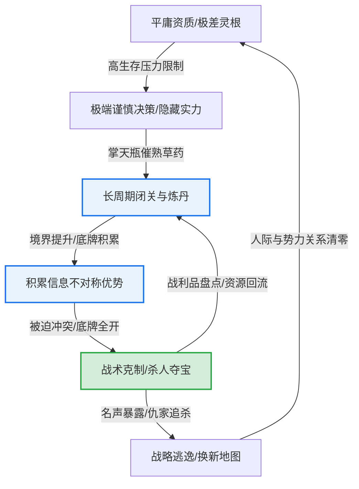
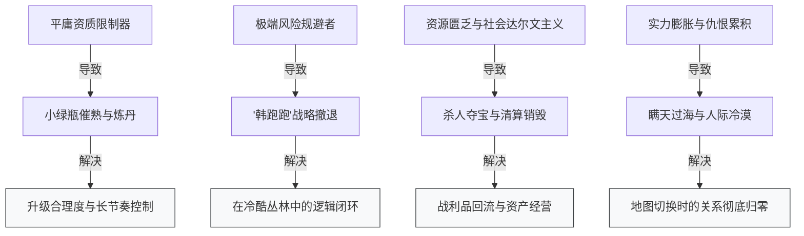

# 《凡人修仙传》叙事结构与读者成瘾机制深度校准报告

> [!NOTE]
> **本报告由 Novel Research Lab 资深小说研究分析师生成**  
> 本报告基于对《凡人修仙传》骨架文本（/Users/liuneng/Documents/Novel Research Lab/phase0A/skeletons/凡人修仙传_skeleton.txt）的计算分析与结构建模，旨在解构该作品的商业化成瘾闭环、叙事特征、公共语汇及可学习的工程机制，并针对 Novel Research Lab 的数据架构（Book DNA、Narrative DNA、State Ledger）提出 Schema 修正建议。

---

## 1. 核心魅力 (Core Appeal)

《凡人修仙传》作为“凡人流”的开山之作，其核心魅力并非传统爽文式的“血脉觉醒”或“天命所归”，而是**平庸个体在极端冷酷的社会化丛林法则中，通过“极致理性与风险控制”实现阶层跃升的成长史诗**。其核心魅力可细分为以下三个维度：

### ① 零背景与差资质的“降维共情”
主角韩立并非天之骄子，而是农家出身，资质仅为平庸的“四属性伪灵根”。这一设定的精妙之处在于**彻底剥离了主角的“宿命光环”**，使读者产生的共情基础不再是“期待奇迹”，而是“代入普通人在严苛环境下的挣扎与奋斗”。韩立的每一次晋升都需要付出数倍于常人的资源，这种“逆水行舟”的设定极大增强了每次突破的叙事张力与读者的成就感。

### ② 极端社会达尔文主义下的“稳健求生”
小说构建了一个极度去道德化、资源绝对匮乏的修仙世界——“散修”处于社会最底层，门派宗门之间充斥着背叛与吞并。在生存压力（Survival Pressure）拉满的背景下，主角以“无利不起早”和“风险规避（Risk Avoidance）”为最高行为准则。他不为虚无的荣誉或正义而战，这种**高纯度的功利主义与战术克制**，高度契合现代社会中个体在竞争压力下的生存焦虑与防卫心理。

### ③ “低调发育”与“极限反杀”的张力对照
韩立在日常叙事中始终维持着“面容普通、皮肤黝黑、毫无存在感”的低调标签，主动隐藏修为（通过敛气术、面具等）。然而，一旦因利益冲突或生存危机被迫出手，他会瞬间展现出“韩老魔”的冷酷狠辣——出手必见生死，不见生死必跑路，得手后毁尸灭迹。这种**日常温吞退让与战斗雷霆手段的强烈反差**，为读者提供了深层且绵长的快感释放。

---

## 2. 读者成瘾机制 (Reader Addiction Mechanics)

《凡人修仙传》的长期读者黏性依赖于一套精密设计的反馈回路，其底层逻辑与**增量放置类游戏（Incremental/Idle Game）**以及**信息不对称博弈**高度契合。

### ① 增量模拟经营闭环：“掌天瓶”的滚雪球机制
“掌天瓶”是该书唯一的成长杠杆，但其功能被严格限定为**“时间加速器（催熟药草）”而非“直接战斗力提成”**。这构建了一个完美的“经营-转化-收割”闭环：
1. **输入（投入）**：时间（避世隐蔽）、灵石（维持法阵）、安全环境。
2. **中间体**：千年/万年药草（通过绿液催熟）。
3. **转化率**：炼制丹药，克服资质差的限制，突破境界。
4. **输出（收益）**：更高的境界、更长的寿元、更强的神识。

读者沉迷于这种**“一分耕耘，十分收获”的微观资源账本**。每一株被催熟的灵药、每一次开炉炼丹的成功率，都是清晰的数值增长反馈，提供了类似模拟经营游戏的成瘾性。

### ② 信息不对称溢价（Information Asymmetry Premium）
爽点不仅来自于主角击败强敌，更来自于**“敌我信息差造成的认知崩塌”**。
* **修为伪装**：韩立在筑基期时示人以练气期，在元婴期时示人以结丹期。当敌人以常规经验评估韩立，试图进行打压或截杀时，韩立瞬间暴露出真实实力或掏出隐秘底牌（如海量傀儡、辟邪神雷、噬金虫）。
* **读者视角优势**：读者全程作为“同谋者”见证韩立如何暗中布置法阵、兜售伪劣符箓、隐藏核心法宝（如三色噬金虫、九曲灵参）。这种“全知视角”让读者在冲突发生前就产生了强烈的期待感（“看这个反派怎么踢到铁板”），形成了长线期待性多巴胺分泌。

### ③ 期望值管理的战术博弈
韩立从不参与无谓的义气之争。每一次战斗，他的决策模型都是**“风险折现率 vs 收益期望值”**：
$$\text{Expected Value} = (\text{Loot Value} \times \text{Win Probability}) - (\text{Life Cost} \times \text{Death Probability})$$
当赢面或战利品（如法宝、功法、灵石）不足以抵消暴露掌天瓶的风险时，他会毫不犹豫地选择“战略性逃逸”。这种高度理性的决策让每一次战斗都显得极其硬核，读者不是在看“主角开挂”，而是在看“一名顶尖操盘手如何最大化每一次冒险的夏普比率（Sharpe Ratio）”。

---

## 3. 标志性特征 (Signature Features)

作为现象级作品，《凡人修仙传》沉淀出了一系列高度符号化的叙事特征与角色行为模式：

| 标志性特征 | 文本表现与具体行为模式 | 叙事效果 |
| :--- | :--- | :--- |
| **韩跑跑 (战略性撤退)** | 一旦神识探测到超出掌控的强者（如元婴老怪或高阶妖兽），或者阵法被破，立刻施展风雷翅、血遁、土遁逃之夭夭。不留一句狠话。 | 强化了世界的真实度与残酷感；避免了主角陷入无尽的强行打脸循环。 |
| **杀人夺宝 (战利品导向)** | 战斗必须伴随储物袋的清算。主角击杀敌人后，第一动作必定是收纳对方储物袋，并使用火球术将尸体烧成灰烬，不留一丝因果。 | 使得战斗成为“资源获取”的合理途径；将情节迅速过渡到“开箱”的爽点反馈。 |
| **小绿瓶 (资源放大器)** | 必须在月光充足处承接灵液，催熟特定年份的药草，作为跨越境界大关的唯一解药。主角必须时刻提防其暴露。 | 确立了升级节奏的独立性，不需要依赖门派施舍；提供了恒定的隐秘任务。 |
| **低调隐忍 (敛气与伪装)** | 日常言语极少，面容黝黑普通，在任何集会中均选择角落位置。频繁使用假名（如“厉飞雨”、“厉道友”）。 | 降低了地图NPC对主角的初始仇恨值；为爆发性的“扮猪吃虎”积蓄叙事势能。 |
| **狡兔三窟 (阵法依赖)** | 无论是在神手谷、落日峰还是乱星海，安营扎寨的第一件事必定是在洞府周围布置多重防御/幻术阵法，并豢养警戒灵兽/傀儡。 | 视觉化了主角的谨慎性格；提供了一个安全稳定的“经营空间”和防御反击基地。 |

---

## 4. 标志性特征背后的深层叙事功能 (Deep Narrative Function of Signature Features)

这五大标志性特征不仅是主角的性格标签，更是忘语在长篇叙事架构中解决**“升级膨胀”与“地图合理转换”**的精密工具：

### ① “韩跑跑”：战术撤退解决“战力通胀与降智反派”的尴尬
在传统玄幻小说中，主角遇到强敌往往靠“临战突破”或“爆种”击败对手。这不仅降低了战力系统的严密性，也会导致反派的行为显得弱智。
* **叙事功能**：通过让韩立“打不过就跑”，作者得以在地图上配置超出主角当前实力数倍的“世界级BOSS”和“真实反派”（如极阴祖师、蛮胡子等）。这不仅增强了世界的危机感，还合理延后了冲突解决的时间线，使得未来的“复仇/反杀”具有极高的延时满足感。

### ② “杀人夺宝”：战利品回流维持“独立经济系统”的自给自足
如果主角只靠天地灵气或宗门供养升级，情节会流于俗套，且受制于门派人际关系。
* **叙事功能**：韩立的法宝（如青竹蜂云剑、风雷翅）和关键配方，绝大多数来源于敌人的储物袋。这构建了一个**“以战养战”的非生产性经济模型**。主角不需要通过讨好师长、做宗门任务来获取资源，只需“被动反击杀敌 -> 继承遗产”，这既保证了主角作为独立散修的自主性，又使每一次激烈的冲突都能直接转化为主角的具体实力增量。

### ③ “小绿瓶”：时间杠杆平衡了“修行慢与升级快”的叙事矛盾
主角资质极差，如果不依靠外力，飞升仙界需要数十万年，故事无法进行；如果给他一个一步登天的功法，又破坏了“凡人”的设定。
* **叙事功能**：掌天瓶将“修行资质问题”转化为了“资源经营问题”。韩立依然需要像普通人一样坐忘、冲关、面对经脉撕裂的痛苦。瓶子的存在让他的快升级有了严密的“逻辑交代”，同时通过“药草年份限制”和“炼丹爆率限制”，作者可以随意微调升级的速度，使其完美契合大纲的节奏控制。

### ④ “低调隐忍”与“假名厉飞雨”：规避高光，保留核心剧情专注度
主角如果名满天下，就会被推向权力和政治的中心，失去自由冒险的游侠属性。
* **叙事功能**：敛气术与多面具的设定，使得韩立即使在元婴期，依然能混迹于筑基期散修的拍卖会中“捡漏”。这种**“高维俯瞰低维”的叙事视角**，不仅制造了极佳的喜剧笑点与反差爽点，更免去了主角处理繁琐宗门政治、虚伪社交的笔墨，使剧情能够高度聚焦于“寻宝、避险、升级”这一核心驱动力上。

---

## 5. 公共类型语汇 (Public Genre Vocabulary)

《凡人修仙传》以一己之力规范并输出了当代仙侠网络文学的行业标准词汇，形成了强大的公共类型语汇库：

### ① 凡人流 (Mortal-Style Protagonist)
指主角天资极差、背景平凡，在没有系统面板等无解外挂的情况下，仅依靠一件辅助性道具，在冷酷、现实的修真界中依靠脑力、谨慎和冷酷逐步成长的流派。

### ② 杀人夺宝 (Kill-to-Loot / Inventory Inheritance)
特指修真界最核心的资源获取手段，核心目的就是击杀对方并夺取其全身家当（储物袋、灵兽袋、本命法宝）。

### ③ 杀伐果断 (Decisive Action / Zero Mercy)
指主角绝无妇人之仁。对待敌人不废话、不妥协、斩草除根，甚至灭杀神魂、火化尸体以防复活或因果追踪，绝不给敌人留下任何“反扑”的伏笔。

### ④ 散修 (Rogue Cultivator / Factionless)
代表修真界最底层的“无产阶级”。他们没有宗门庇护，没有稳定的灵气福地，只能在各大坊市、险恶秘境中抱团或互害，是修真界中最现实、最狡诈的阶层。

### ⑤ 坊市 / 拍卖会 / 交换会 (Cultivation Markets & Nodes)
修真界中的资源流动和信息交换中心。取代了传统的世外桃源设定，将修真界彻底“资本化”和“市场化”，提供了以灵石为一般等价物的基础货币体系。

---

## 6. 高识别度组合 (High Recognition Combos)

在韩立的漫长修仙路上，忘语重复使用了几套极高识别度的情节或战术套路，形成了标志性的叙事指纹：

### ① 战术交战套路：“防御反击”阵地战组合
韩立从不轻易与人发生遭遇战或肉搏战。一旦进入战斗，他的标准战术链条如下：

* **战术内核**：极高的人身安全防卫阈值。傀儡与飞剑负责御敌于千里之外，本命辟邪神雷负责克制魔功与一击致命，风雷翅与血遁符提供保底退路。

### ② 宏观 pacing 曲线：“换图-重置-开荒”套路
每当韩立在当前地图（如天南）达到瓶颈，或者因为惹了超级大敌（如六足、魔族圣祖）无法生存时，就会发生以下图谱事件链：
1. **强制换图**：通过上古传送阵、虚空裂缝或飞升（如飞入乱星海、魔渊、灵界、仙界）。
2. **状态重置（软/硬降级）**：
   * **硬降级**：如刚飞升仙界，仙元力未转化，在真仙眼里依然弱如蝼蚁，或者修为暂时受损、法宝被夺。
   * **软降级**：进入一个平均修为极高的新世界，原本的一方霸主重新变成底层小辈。
3. **开荒种药**：隐姓埋名，寻找一处偏僻灵脉或加入一个小势力，重新开启“催熟药草-炼丹突破-敛气扮猪”的循环。

---

## 7. 可学习机制 (Learnable Mechanisms)

对于小说创作工具或AI生成大纲模型，《凡人修仙传》有极高工业价值的叙事机制可以被提取并复用：

### ① 资源约束型升级模型 (Resource-Constrained Progression Engine)
传统的爽文升级往往是“顿悟”或“愤怒突破”。《凡人》提供了一个可数学建模的升级机制：
* **公式化升级阈值**：主角的每一次突破，都必须满足以下资源公式：
  $$\text{Breakthrough Probability} = f(\text{Natural Aptitude} \times \text{Pill Potency} \times \text{Pill Quantity} \times \text{Formulas Unlocked})$$
* **工程可学习点**：在 AI 生成大纲时，必须将主角的升级过程设计为**“寻找配方 -> 搜集药草 -> 炼丹挫败 -> 数量堆叠突破”**的连贯任务链。每一次升级都有清晰的前置成本和明确的“农业准备期”，这能有效避免主角战力无序飙升。

### ② 风险评估与闪避算法大纲控制 (Threat Analysis & Evasion Algorithm)
AI 生成剧情时，常犯的错误是让主角不论遇到什么敌人都硬刚到底。
* **工程可学习点**：为主角建立一个“威胁分级评估模块”。在进入任何秘境或卷入冲突前，要求大纲生成器先为主角规划**三条退路**（如：遁术、替身傀儡、后手阵法）。一旦敌方表现出超出主角 15% 以上的战力，剧情必须强行转入“撤退/智斗规避/引敌入瓮”分支。这能极大提升智斗的真实感和紧张度。

### ③ 战利品盘点与资产表驱动（Asset Inventory & Loot Clearing）
* **工程可学习点**：在后台维护一张不可变的 **Protagonist State Ledger（主角资产账本）**。每次战斗结束后的 1-2 章内，必须有明确的“清点储物袋”情节。被清点的法宝、符箓、灵石必须在后续战斗中得到损耗或消耗的体现（例如：金符用了就少一张，法宝碎了需要重新炼制）。这种细节账本能给读者提供极其扎实的物理真实感。

---

## 8. 必须避免的低级缝合风险 (Avoiding Low-Level Copycat Risks)

模仿“凡人流”的劣质作品极多，在设计相关模型或大纲时，必须避开以下“低级缝合”雷区：

### ① 口头谨慎，身体诚实 (Pseudo-Caution / Contradictory Actions)
* **避雷指南**：许多缝合文给主角贴上“性格稳健、苟、低调”的标签，但一遇到宗门师姐被调戏、或者拍卖会出现稀世宝物时，为了所谓的“念头通达”，依然会高调出风头、挑衅背景深厚的年轻一代。这会彻底瓦解“凡人流”的逻辑基石。主角的谨慎必须是**全方位的利益最大化与生命第一性原则**，面子和名誉在生命面前一文不值。

### ② “小绿瓶”等作弊器的过度膨胀 (Cheat Over-Powering)
* **避雷指南**：在隐秘设定中，金手指定位不能拥有秒杀强敌或随意改写规则的功能。一旦辅助道具可以直接作为武器，主角就失去了“平庸凡人靠脑力经营生存”的底色。必须严格卡死金手指的输出端：**它只能作为时间加速或资源增量工具，不能作为暴力输出手段**。

### ③ 掠夺因果的失效 (Looting without Retaliation)
* **避雷指南**：主角杀了大势力的少主并抢了储物袋，却没有任何追踪机制，或者追踪痕迹被主角随手抹去，大势力也极易放弃追查。在《凡人》中，“杀人夺宝”是伴随着极大因果诅咒的（如：墨大夫的尸虫丸、门派本命牌、血魂契约、万里追踪印记）。每一次夺宝都应当埋下**“长线危机”**的引线，促使主角必须换地图或闭关，形成合理的生存压迫感。

---

## 9. 对 Book DNA / Narrative DNA / State Ledger 的 schema gap (Schema Gaps on DNA & Ledgers)

传统的 Novel Research Lab 数字化模型在试图解析《凡人修仙传》这类型作品时，暴露出了明显的底层设计缺陷（Schema Gaps）。现有的静态与线性分析框架无法完美还原其动态的成瘾与生存逻辑。

### ① 对 Book DNA（静态特征）的 Schema 缺陷
传统的 Book DNA 倾向于统计全局词频、人物静态属性（如灵根、战力初始值、血脉）以及经典的门派关系。
* **Aptitude Negativity Metric（资质负值度量失效）**：现有 schema 默认主角的资质即使不好，也是“待觉醒的至尊体”或“被封印的神脉”。无法表达《凡人》中韩立这种**“纯粹的伪灵根（物理缺陷且无法修复）”**。缺少表示“成长阻力系数”的字段。
* **Disguise & Pseudo-Identity Fields（伪装与马甲映射缺失）**：Book DNA 无法建模“韩立-厉飞雨-韩老魔-马石”的多重假名与不同身份下的名声值（Reputation Ledger）。在静态图谱中，这些马甲常被割裂为不同实体，或简单归并，丢失了“用马甲分担因果”的叙事权重。

### ② 对 Narrative DNA（结构脉络）的 Schema 缺陷
现有的 Narrative DNA 沿用经典“英雄之旅”或“斗破式打脸”的情绪弧线（“受辱 -> 闭关 -> 复仇”）。
* **Evasion & Non-Confrontation Nodes（规避与非对抗节点缺失）**：无法解析“冲突爆发后主角直接逃跑，并在两百章内不予正面回应”的叙事断层。在传统大纲模型中，这会被判定为“情节流产/断更/烂尾”，但它在凡人流中是核心的情绪延时满足机制。
* **Decoupled Map Transition Reset（地图强解耦与重置机制缺失）**：凡人流的特征是“换地图即重置社会关系”。一旦飞升或换海域，原先建立的所有门派、师徒、敌对关系链在几百章内彻底清空。现有 Schema 倾向于构建长线的人物关系网，无法容纳这种**“断代式、胶囊化”的叙事空间切换**。

### ③ 对 State Ledger（状态账本）的 Schema 缺陷
目前的 State Ledger 仅支持记录简单的“等级（LV）”、“当前灵石数（Money）”和“装备列表（Inventory）”。
* **Information Exposure Layer (信息暴露分层缺失)**：Ledger 无法区分“外界感知的属性”与“主角真实的隐藏属性”。例如：
  $$\text{State}_{\text{Public}} = \{\text{Cultivation}: \text{筑基初期}, \text{Items}: \text{普通飞剑}\}$$
  $$\text{State}_{\text{Private}} = \{\text{Cultivation}: \text{元婴中期}, \text{Items}: \text{掌天瓶}, \text{三色噬金虫}, \text{九曲灵参}\}$$
  如果 Ledger 不做“信息暴露度”的分层（Public vs Hidden），AI 辅助生成或结构分析就无法理解主角“扮猪吃虎”和“战略欺骗”的叙事合理度。
* **Asset Depreciation & Consumable Tracking (资产折旧与易耗品追踪缺失)**：在战斗中，符箓的消耗、阵旗的破损、灵兽的沉睡没有被动态扣减，导致 Ledger 变成了只增不减的堆积，无法还原真实的“资源危机感”。

---

## 10. 对 Novel Research Lab 架构的修正建议 (Architecture Recommendations for the Lab)

为了支持对《凡人修仙传》等硬核谨慎资源流小说的深度数字化分析，建议对 Novel Research Lab 的数据架构与解析引擎进行如下升级：

### ① 在 Book DNA 中引入“风险规避与性格矩阵特征字段”
* 增加 **Caution Index（谨慎系数）**：通过扫描文本中表示风险防范的词汇（如：隐藏、倒退、布阵、易容、化名、谨慎、冷冷）的密度，量化角色的风险偏好。
* 增加 **Aptitude Penalty Multiplier（资质惩罚乘数）**：用于衡量主角在初始修行时，突破瓶颈所需的外部资源量（丹药/灵脉）相较于普通NPC的倍数，从而量化成长故事的硬核程度。

### ② 在 Narrative DNA 中新增“叙事胶囊（Narrative Capsules）”与“战略折现节点”
* 开发 **Map Transition Capsule Class**：定义“地图边界”。当主角触发跨图事件时，系统自动对前一阶段的 State Ledger 人际关系网进行“归档（Archive）”处理，开启一个崭新的“生存开荒模板（Survival Onboarding Template）”，并在新模板中限制旧社交资产的调用。
* 引入 **Anti-Climax Nodes（反高潮/避战节点）**：允许大纲模型在检测到高阶敌人时，生成“绕行、投毒、信息误导、远遁千里”的情节路径，并对避战所产生的“名誉受损”与“生命安全增量”进行双向记账。

### ③ 重构 State Ledger 为“双轨信息分层账本 (Dual-Track State Ledger)”
将主角的状态划分为两个独立的视图：
1. **Public View (公开掩码层)**：NPC所能探测到的修为、法宝、战意。
2. **True View (真实暗箱层)**：实际拥有的杀手锏、暗算底牌、金手指核心状态。
3. **Asymmetry Ratio（信息不对称指数）**：
   $$\text{Asymmetry Ratio} = 1 - \frac{|\text{Public View} \cap \text{True View}|}{|\text{True View}|}$$
   利用该指数来动态预测接下来的剧情中发生“低调反杀/扮猪吃虎”的爽点爆发概率。

---
*报告撰写完毕，已存入指定归档目录。*
*存档路径：[凡人修仙传_reading_discovery_report.md](file:///Users/liuneng/Documents/Novel%20Research%20Lab/phase0A/02_reading_reports/%E5%87%A1%E4%BA%BA%E4%BF%AE%E4%BB%99%E4%BC%A0_reading_discovery_report.md)*
