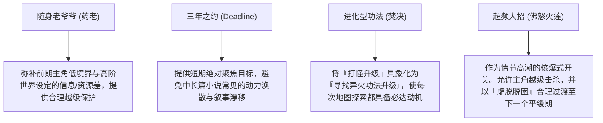

# 《斗破苍穹》叙事架构与商业节奏分析报告

> [!NOTE]
> **定位声明**  
> 本报告由 Novel Research Lab 特约分析师撰写，旨在从叙事工程学与商业化机制的角度，深度解构网文黄金时代标杆作品《斗破苍穹》的结构成功学。本报告摒弃传统的感性文学评论，聚焦于其背后的“抑扬动力学”、“双轨升级算法”及“地图切换重置机制”。

---

## 1. 核心魅力 (Core Appeal)

《斗破苍穹》的核心魅力并非来自于繁复的文笔或深邃的哲学探讨，而是来自于**极致的商业化叙事效率**与**具象化的成长收集驱动**。

*   **负向情绪债的极致压缩与释放（情绪动力学）**：通过“天才陨落 + 退婚羞辱 + 家族边缘化”的极端压迫开局，在故事极早期建立起庞大的“情绪负债”。这为主角后续的每一次突破和复仇提供了无可比拟的底层拉力，使读者的代入感与反弹渴望达到峰值。
*   **高可见度与强确定性的“异火收集表”（收集驱动）**：小说引入了“异火榜”这一系统。异火不仅是战斗力的终极载体，更是具体的、可数的、具有独特属性与排名的“珍稀资产”。这种“收集癖”驱动（类似卡牌收集或成就解锁）将抽象的实力提升转化为极其直观的物理进度条。
*   **目标向量的聚焦（三年之约）**：有别于多数网络小说中“成为最强”的空泛长线目标，本书在开局即确立了“三年之约”这一具有绝对时限（Deadline）、极高社会声誉利害关系（Stakes）的阶段性核心任务，强力拉动了前 300 章的叙事推进力。

---

## 2. 读者成瘾机制 (Reader Addiction Mechanics)

《斗破苍穹》构筑了一套高闭环、强正反馈的“多重成瘾回路”，在商业节奏上实现了读者多巴胺的精准控制：

*   **抑扬交替的周期性振幅（压迫-释放循环）**：
    *   **抑（憋屈期）**：主角面临跨阶敌人的压迫、资源的匮乏、或者修炼瓶颈（如吞噬异火的濒死痛苦）。
    *   **扬（打脸期）**：主角在众目睽睽之下展现实战底牌、炼药神技或完成越级反杀。
    *   每一轮“抑扬”的波长控制在 10-30 章内，确保读者在感到疲劳前获得即时满足。
*   **战斗力与社会声望的“双轨升级制”**：
    *   **主轨（斗气境界）**：提供绝对武力上限，属于传统的物理破坏力维度（斗者 $\rightarrow$ 斗师 $\rightarrow$ ... $\rightarrow$ 斗帝）。
    *   **辅轨（炼药师身份）**：提供极高的社会资源溢价、人脉网络与经济特权（一品 $\rightarrow$ 九品）。辅轨允许主角在武力尚低时，跨阶获得强者的敬畏与庇护，从而实现“低武力、高地位”的爽感错位。
*   **“降维重置”与“资产保留”的地图过渡算法**：
    *   每当主角在当前地图（如乌坦城、加玛帝国）达到战力天花板后，立即通过空间转换进入全新地图（如黑角域、迦南学院、中州）。
    *   在新地图中，主角的相对武力阶层被瞬间“重置”为底层或中层，从而开启新一轮的“压迫-蓄势-反击”循环；然而，主角的核心资产（如异火、焚决功法、炼药术）得以完全保留，使读者在“重新做人”的危机感中依然享有“降维打击”的潜在心理优势。
*   **多层级旁观者反馈机制（情绪倍增器）**：
    *   小说的爽感并不单由战斗结果决定，而是通过大量旁观者的“震惊”、“悔恨”、“骇然”进行二次确认。
    *   旁观者通常分为“同辈（产生直接嫉妒）”、“老辈专家（产生权威背书）”、“敌方统帅（产生绝望与悔恨）”，通过层层递进的社会学反馈，成倍放大读者的心理满足感。

---

## 3. 标志性特征 (Signature Features)

作为商业网文的模板级作品，其标志性特征表现为高度符号化的情节元件：

*   **“退婚开局”与“莫欺少年穷”**：将阶层压迫与性别/情感羞辱熔于一炉，形成无可妥协的荣誉冲突。
*   **“随身老爷爷”（药老）**：随身携带的顶级导师与资源库，作为外挂机制的实体化呈现。
*   **“焚决功法”（进化型功法）**：打破传统功法品阶固定的桎梏，通过吞噬异火实现动态升级，将功法成长与主线冒险深度绑定。
*   **“佛怒火莲”（系统超频技能）**：将本不可融合的异火强行压缩融合，形成超越自身境界极限的毁灭性大招。
*   **“势力宿敌”（魂殿 / 魂族）**：贯穿始终的终极黑手，为主角的地图迁移与战力提升提供源源不断的防御性动机（救父、救师、救世）。

---

## 4. 标志性特征背后的深层叙事功能 (Deep Narrative Function of Signature Features)

从叙事工程的角度看，上述特征并非单纯的情节拼凑，而是解决网文连载核心痛点的“系统级插件”：

*   **药老（导师插件）的深层功能**：解决了“新手期主角如何接入高等级世界规则”的矛盾。药老作为曾经的斗尊与八品炼药师，担任了规则解释器、高等级道具配方提供者，并在主角面临致死性降维打击时提供“合理免死”，确保故事在合理逻辑内推进。
*   **三年之约（目标插件）的深层功能**：为连载初期树立了清晰的“完结倒计时”，将散乱的野外打怪、坊市淘金、炼药竞赛全部收纳进“为三年之约备战”的逻辑链条中，实现了极高的数据内聚力。
*   **佛怒火莲（超频插件）的深层功能**：解决了“越级强杀”导致的战力崩溃问题。此招威力巨大但副作用极强（脱力、灵魂受创、消耗异火能量），使用后主角必须陷入“衰弱逃亡”或“闭关休养”状态。这在叙事上自动形成了**“高潮爆发 $\rightarrow$ 战力低谷 $\rightarrow$ 遁走调养”**的天然节奏缓冲，避免了主角战力无限膨胀无法收缩的困境。

---

## 5. 公共类型语汇 (Public Genre Vocabulary)

《斗破苍穹》极大地规范并推广了中国网络玄幻小说的公共类型语汇，形成了行业事实上的标准化协议：

*   **字面化、可视化的实力阶梯（境界协议）**：将修真小说的“筑基-结丹”重构为更具动感与清晰阶层划分的“斗气大陆境界谱系”（斗者、斗师、大斗师...）。每个境界具有特征明确的物理表现（如：斗气纱衣、斗气化翼、空间穿梭、执掌源气），极大降低了读者的认知门槛。
*   **装备/技能的标准化分类（天/地/玄/黄）**：功法与斗技的四阶十二级划分，成为后续无数系统流、玄幻小说沿用的标准化分类模版。
*   **炼药职业的子系统规范**：定义了“药鼎、控火、灵魂感知、药草提纯、丹雷劫”的炼药全流程，使副职业修仙成为能够独立支撑叙事线的核心子系统。
*   **“黑角域”式的灰色缓冲带**：Codified 了一种介于“文明帝国”与“终极中州”之间的“三不管、无法无天、高收益高风险”的黑市/混乱地图，用以释放主角在守序阵营无法展现的杀伐果断与财富掠夺。

---

## 6. 高识别度组合 (High Recognition Combos)

在叙事配方中，以下三大组合构成了本书的“商业招牌”，其识别度极高且难以被轻易替换：

*   **【天骄陨落 + 退婚羞辱 + 莫欺少年穷誓言】**：
    *   **公式**：高起点落差 + 契约撕毁 + 尊严宣誓。
    *   **效果**：在一万字内制造全书最强的情感张力，将家族内部斗争迅速升级为跨宗门的社会等级冲突。
*   **【极低武力值 + 极高炼药师等级 + 跨阶强者随从】**：
    *   **公式**：主角战力赤字 + 社会身份盈余 + 隐藏暴力外挂。
    *   **效果**：在主角还是“斗者”时，即可利用“二/三品炼药师”身份在城邦间博弈，甚至雇佣“斗皇”级强者（如海波东）充当保镖，形成独特的叙事杠杆。
*   **【异火吞噬 + 焚决进化 + 佛怒火莲融合】**：
    *   **公式**：自残式升级 + 功法重构 + 跨阶核武。
    *   **效果**：将收集到的道具（异火）直接转化为功法进化经验值，并自动解锁战术核打击（火莲），使“收集-成长-战斗”三个叙事环节实现无缝咬合。

---

## 7. 可学习机制 (Learnable Mechanisms)

对于现代网文创作或交互式故事生成模型，以下机制是《斗破苍穹》最值得抽取的工程经验：

*   **“前置铺垫与情绪负债”机制**：在引入核心敌对势力（如云岚宗、魂殿）时，必定先安排其对主角的社会关系（如父亲失踪、师傅被抓、家族被屠）进行毁灭性打击。**不制造无法调和的伤害，就不开启下一张大图的战斗**。
*   **“多层次侧面震惊法”的标准化节奏**：
    1.  **第一层（路人/反派）**：嘲讽主角不自量力。
    2.  **第二层（主角展现底牌）**：反派震惊，路人失声。
    3.  **第三层（现场最权威的长辈/宗师）**：起立，详细解释主角这一招在学术上/历史上的恐怖之处，为主角的牛逼提供“官方定义”。
    4.  **第四层（隐藏在暗处的顶级强者）**：暗中惊叹，决定结交或铲除主角。
*   **“破境瓶颈的物理痛苦化”**：主角的晋级不能是轻松的点按升级，必须伴随肉体煎熬（如异火焚身、筋骨重塑）。这种“痛苦描写”不仅增强了故事的真实感，更是**在叙事逻辑上对主角越级战力合理性的“支付代价”**。读者会默认：主角承受了非常人能忍受的痛苦，所以他获得超人力量是合情合理的。

---

## 8. 必须避免的低级缝合风险 (Avoiding Low-Level Copycat Risks)

在套用《斗破苍穹》模板时，容易陷入以下低级缝合陷阱，导致叙事崩盘：

*   **“无脑压迫”导致的读者心理疲劳**：如果反派的打压毫无逻辑，仅仅是为了打压而打压，且主角长期得不到有效反弹，读者会在极度憋屈中流失。必须确保**“每次压迫都有明确的时限与反击路线图”**。
*   **“随身老爷爷”喧宾夺主**：若老爷爷沦为无所不能的自动防卫系统，主角的自主决策与成长将失去意义。必须在关键节点（如云岚宗大战后）将老爷爷“封印/抓走”，切断安全感，强制开启主角的“独立自主期”。
*   **“地图切换导致的人脉荒漠化”**：如果主角每换一个地图，就把之前的红颜知己、亲人、结盟势力彻底抛弃，角色将显得冷酷无情，且世界观会显得廉价。必须通过“长线宿敌（魂殿）的追杀”或“寻找父亲/师傅”等主线纽带，将不同地图的人脉有机穿联。
*   **“战力通胀导致的计量单位崩溃”**：在新地图中，原先高不可攀的“斗皇”沦为看门狗。若无合理的设定缓冲，会导致世界观战力系统雪崩。需引入“中州庞大的空间基底与源气稀缺”等宏观设定来解释战力密度的差异。

---

## 9. 对 Book DNA / Narrative DNA / State Ledger 的 schema gap (Schema Gaps on DNA & Ledgers)

Novel Research Lab 现有的底层数据模型（Schemas）在解析《斗破苍穹》时暴露出显著的兼容性缺陷（Schema Gaps）：

### ① State Ledger (状态账本) 的 Schema Gap
*   **无法描述“非线性进化的功法系统”（焚决特征）**：
    *   *现有 Schema*：通常将功法/技能视为静态列表或线性熟练度升级（Lv.1 $\rightarrow$ Lv.10）。
    *   *Gap 表现*：无法建模《斗破苍穹》中“焚决功法通过吞噬特定道具（异火）动态改变自身评级（黄阶低级 $\rightarrow$ 地阶 $\rightarrow$ 天阶）”的跃迁特征。
*   **缺乏“双轨升级与相互溢价”的耦合模型**：
    *   *现有 Schema*：战斗职业与副职业（炼药师）的等级彼此隔离，独立计算。
    *   *Gap 表现*：无法计算“炼药师等级对武力境界的杠杆增益”。例如，萧炎在“大斗师”境界时，因为具备“四品炼药师”身份，其实际“社会声望/话语权指数”应当锚定为“斗皇”甚至“斗宗”。

### ② Narrative DNA (叙事DNA) 的 Schema Gap
*   **缺少“情绪振幅与抑扬比”（Suppression-to-Release Ratio）的度量指标**：
    *   *现有 Schema*：仅能标记剧情节点类型（如“战斗”、“日常”、“突破”）。
    *   *Gap 表现*：无法量化**“负向情绪积累期（憋屈/被打压的字数规模）”与“正向情绪爆发期（反击/装逼打脸的字数规模）”的黄金比例**。这导致模型在自动生成时无法精确复刻斗破的“成瘾波长”。
*   **缺乏“第三方震惊指数”（Bystander Reaction Index）的结构化统计**：
    *   *现有 Schema*：将震惊的旁观者归类为普通的“背景NPC”或“对话参与者”。
    *   *Gap 表现*：丢失了旁观者在情绪高潮中充当“弹幕/爽感增幅器”的独特叙事价值，无法计算出“围观者规格越强，爽点爆发力越高”的乘数效应。

### ③ Book DNA (作品DNA) 的 Schema Gap
*   **“本地战力标尺”与“全局战力标尺”的汇率偏差（Map Scale Coefficient）**：
    *   *现有 Schema*：战力采用绝对值（如武力值 1-100）。
    *   *Gap 表现*：在地图转换时，原先战力 90 的斗皇在加玛帝国是神，到了中州变成战力 30 的杂兵。若无“地图相对折算系数”，模型在分析中州剧情时会错误地判断战力系统已经崩溃，或者无法合理计算新地图敌人的初始威胁值。

---

## 10. 对 Novel Research Lab 架构的修正建议 (Architecture Recommendations for the Lab)

为了支持以《斗破苍穹》为代表的经典商业爽文架构的精确建模与生成，建议对 Lab 架构进行如下修正：

*   **引入“资产-功法联动 Ledger”**：
    *   在 State Ledger 中，允许特定技能（如 evolution-type skill）订阅 Inventory（背包账本）中特定道具（如 Heavenly Flames）的变更事件。一旦吞噬事件发生，自动重置技能的功法等阶（Grade）与基础系数。
*   **增设“双轨溢价与特权折算矩阵”（Social Leverage Matrix）**：
    *   引入社会声望折算公式：
        $$\text{Social Influence} = f(\text{Combat Rank}, \text{Alchemist Rank}) = w_1 \cdot \text{Combat Rank} + w_2 \cdot (\text{Alchemist Rank})^k$$
        其中，副职业指数 $k > 1$ 且具备跨越阶层的乘数效应，用以准确评估主角的社会博弈能力。
*   **新增“情感负债与偿还账本”（Emotional Debt Ledger）**：
    *   在 Narrative DNA 中增加情绪流追踪器。每发生一次“被打压事件”，根据打压方的规格、社会羞辱程度累加“情绪负债值（Emotional Debt）”；主角的每次突破和反击则是“偿还负债”。模型必须监控情绪负债不超标（防止憋屈致死），同时在爆发点将负债迅速清零，以实现最大多巴胺释放。
*   **开发“相对战力折算插件”（Spatial Scaling Plug-in）**：
    *   为 Book DNA 引入 Map 概念。每个 Map 附带一个“本地战力膨胀系数 $\beta$”。NPC 的实际威胁度由绝对实力与所在 Map 的 $\beta$ 共同决定：
        $$\text{Relative Threat} = \frac{\text{NPC Absolute Rank}}{\text{Map Base Line Rank}}$$
        这能让分析引擎在主角换地图时，自动理解为何低级怪物的威胁感会重新拔高，并维持合理的叙事张力。

---
*报告完毕。本报告数据及结论已归档至 Phase 0A 升级爽文研究专项。*
