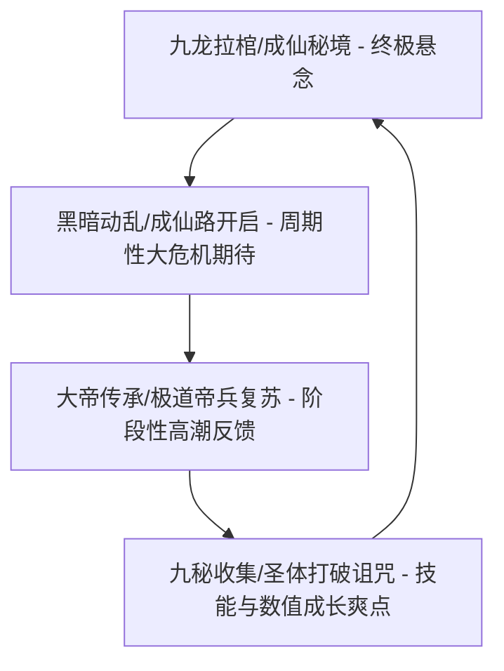
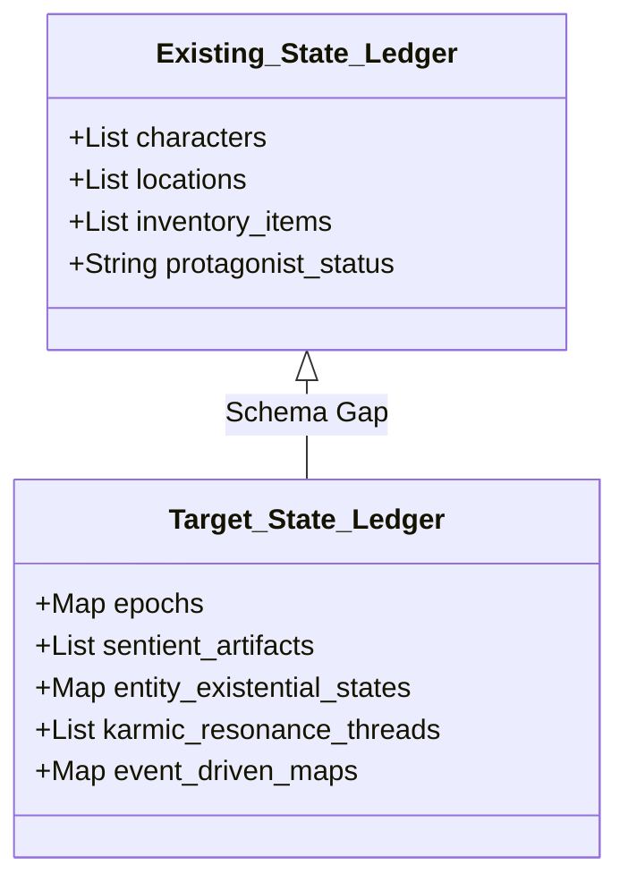

# 《遮天》小说结构与叙事架构深度解构报告
**项目阶段**：Phase 0A  
**定位**：小说研究实验室（Novel Research Lab）专用校准与标杆分析报告  
**分析对象**：《遮天》  

---

## 1. 核心魅力 (Core Appeal)

从叙事工程与文学架构的角度来看，《遮天》的核心魅力建立在**宏大空间跨度、宿命悲剧色彩、以及群像叙事的极限释放**之上。其核心魅力可解构为以下四个维度：

*   **极致的宇宙苍凉感与空间尺度扩展**：小说以“九龙拉棺”这一极具视觉冲击力和悬念感的意象开篇，迅速将叙事背景从渺小的地球跨越到荒古星空。通过“深空探索 -> 荒古星域 -> 五域大洲 -> 星空古路 -> 奇异世界/仙界”的阶梯式地图切换，创造了网文历史上少有的、融合了科幻深空冰冷感与荒古仙侠苍茫感的独特宇宙观。
*   **大帝纪元的“诸神黄昏”与悲剧宿命**：大帝（极道至强者）在本书中被赋予了极强的人格张力。大帝并非高高在上的无情神明，而是背负着“大帝两难”宿命的悲剧英雄。为了庇护人族，虚空大帝血战至死，太阳圣皇只剩半张人皮亦要战至最后一刻；而为了长生，古代至尊被迫自斩一刀，沦为禁区主宰，在成仙路开启时发动黑暗动乱收割万灵。这种“英雄谢幕”与“信仰崩塌”的宏大悲剧交织，构成了全书最强烈的宿命宿怨感。
*   **群像史诗的众星闪耀**：主角叶凡并非孤立的升级机器，其成长伴随着姜太虚、盖九幽、姬子、圣皇子等一代代豪杰的崛起与谢幕。每一个配角都拥有独特的“道”与“人生弧光”，在黑暗动乱来临时共同谱写出一曲悲壮的赞歌。
*   **高纯度的情绪振幅与热血/文气融合**：辰东极其擅长使用“文气”极高且极具感官刺激的战斗描写与语汇（如“仙路尽头谁为峰，一见无始道成空”、“我为天帝，当镇杀世间一切敌”），在关键节点将读者的情绪推向极致，形成强烈的爽点与痛点共鸣。

---

## 2. 读者成瘾机制 (Reader Addiction Mechanics)

《遮天》成功的核心在于其精密设计的多层成瘾与悬念回路：



*   **“九龙拉棺-仙域受损”的终极悬念牵引**：从第一章开始，九龙拉棺的来源、小棺内的世界、仙域的真相便作为主线悬念悬挂于读者头顶。读者为了寻找这些终极答案，愿意忍受中期长达数百万字的地图漂泊。
*   **“成仙路开启”的周期性宏观大事件期待**：小说通过不断提及“成仙路将要在这一世开启”，建立了一个贯穿全书的“宏观定时炸弹”。读者时刻在期待这一纪元终结、万古至尊齐出的终极高潮（黑暗动乱），这种长线期待大大提高了读者的留存率。
*   **“大帝符号”的崇拜与继承机制**：大帝是力量的极点与信仰的载体。主角每一次接触大帝遗迹、得到大帝经文、或是复苏极道帝兵（如虚空镜、恒宇炉），都是对读者“大帝崇拜”心理的强力反馈。
*   **高频且有尊严的“越级挑战与逆境爆发”**：主角作为“荒古圣体”，修行路受天地诅咒，每一次突破都伴随着圣地截杀与天劫惩罚。这种“举世皆敌”的压迫感，使得主角每次依靠“六道轮回拳”和“异火/万物母气”翻盘时，读者获得的成就感呈几何级数放大。

---

## 3. 标志性特征 (Signature Features)

《遮天》的核心设定可以提炼为以下六个高识别度的标志性特征：

1.  **九龙拉棺 (Nine Dragons Coffin)**：宇宙级星际航行器与世界载体，连接地球、荒古世界与仙域的虚空枢纽。
2.  **古史断层与九秘 (Ancient History Fractures & Nine Secrets)**：神话时代、太古时代、荒古时代的纪元更迭，将最顶级的九种技能（九秘）分散在不同的历史遗迹中，引导主角通过考古与探秘完成技能收集。
3.  **生命禁区与自斩至尊 (Forbidden Zones & Self-Chopping Supremes)**：北斗星域的七大生命禁区（荒古禁区、太初古矿、不死山等），隐藏着曾经统治宇宙但自斩神识、依靠吸食万灵生命力苟延残喘的古代至尊。
4.  **极道帝兵 (Imperial Weapons)**：大帝生命与大道的延续，拥有独立的自我意识与情感绑定，是圣地与世家底蕴的终极威慑力量。
5.  **黑暗动乱 (Dark Turbulence)**：自斩至尊为了活命而在成仙路开启失败后发动的宇宙级收割，是整部小说情绪烈度最高、配角牺牲最惨烈的大型灾难战役。
6.  **相似的花 (Similar Flowers)**：一种独特的、超越传统转世概念的情感回响机制（如安妙依与寇晓晓，狠人哥哥与叶凡），在角色逝去后提供长线的情感救赎与悬念。

---

## 4. 标志性特征背后的深层叙事功能 (Deep Narrative Function of Signature Features)

这些标志性特征并非孤立的爽点设定，它们在小说中承担着关键的叙事工程学任务：

| 标志性特征 | 叙事工程学功能 | 解决的叙事痛点 |
| :--- | :--- | :--- |
| **九龙拉棺** | 建立跨星域、跨纪元的时空锚点，既是开局的悬念，也是终局修补仙域的物理载体。 | 避免了传统玄幻小说后期世界观崩塌、主角飞升后与前期地图完全脱节的通病。 |
| **古史断层与九秘** | 将战力升级与历史考古相结合，主角的技能获取必须通过探寻历史隐秘来实现。 | 解决了“主角换个地图换套技能，技能库无限膨胀却毫无深度”的数值化弊端。 |
| **禁区与至尊自斩** | 建立永久性的、超越当前地图等级的“终极危险源”。禁区在前期即登场，且贯穿始终。 | 避免了“打完小怪来大怪，怪物的出现缺乏前置铺垫和世界观合理性”的机械升级感。 |
| **极道帝兵** | 作为圣地势力的底蕴保障，同时允许低阶配角通过“唤醒/献祭”帝兵强行参与高阶战斗。 | 解决了随着主角战力飙升，前期圣地和核心配角迅速沦为背景板、无法参与高潮战役的难题。 |
| **黑暗动乱** | 触发全宇宙级别的战力大重置与信仰大考验，将个体升级的私欲上升为种族存亡的圣战。 | 打破了“个人恩怨”的狭隘格局，提供极致的悲壮感，将读者的情绪能量释放到极限。 |
| **相似的花** | 在不破坏“死亡即消逝”的残酷真实性前提下，提供情感连贯性与回响。 | 解决了配角死亡后情感链条断裂的遗憾，给读者提供温暖的心理补偿。 |

---

## 5. 公共类型语汇 (Public Genre Vocabulary)

《遮天》对中文网络文学作出了巨大的语汇贡献，成功将以下词汇或概念定义为行业通用的公共语汇：

*   **大帝 (Great Emperor)**：在《遮天》之前，“帝”多为凡尘帝王或天庭职衔。本书将“大帝”定义为“一个纪元只能诞生一位、万道承载、举世无敌但寿命有限”的修行极点，确立了大帝的唯一性与悲壮感。
*   **自斩 (Self-Chopping)**：特指至强者为了规避天道惩罚或长生限制，主动斩去自身一部分本源或境界，以陷入沉睡的状态存活。
*   **禁区 (Forbidden Zones)**：特指由自斩至尊盘踞、连大帝都不愿轻易开战的绝对死地，成为后世玄幻小说中“生命禁地”的标准模板。
*   **晚年不详 (Late-stage Ominous)**：特指某种强大体质（如荒古圣体、源天师）在修行末期必然遭遇的神秘厄难，现已被广泛应用于各类网络文学中作为“晚年天人五衰”的代名词。
*   **红尘仙 (Redust Immortal)**：打破“飞升成仙”的传统套路，指在仙路断裂、长生物质缺失的红尘世界中，通过一世又一世的不断涅槃蜕变（如叶凡九世成仙，狠人红尘蜕变），最终强行证得长生。

---

## 6. 高识别度组合 (High Recognition Combos)

在进行IP衍生或创作借鉴时，以下三个高识别度元素组合具有极高的商业与叙事价值，不能轻易拆散：

```
组合 A (史诗战役核心)
┌────────────────────────────────────────────────────────┐
│  大帝 (唯一主宰) + 极道帝兵 (本源法宝) + 禁区 (蛰伏点)  │
└────────────────────────────────────────────────────────┘
                          │ (触发)
                          ▼
             成仙路开启 / 黑暗动乱 (宇宙浩劫)

组合 B (世界探索核心)
┌────────────────────────────────────────────────────────┐
│         九龙拉棺 (交通/悬念) + 星空古路 (关卡地图)      │
└────────────────────────────────────────────────────────┘

组合 C (主角战斗流派)
┌────────────────────────────────────────────────────────┐
│     荒古圣体 (血脉) + 六道轮回拳 (招式) + 异象 (领域)    │
└────────────────────────────────────────────────────────┘
```

*   **组合A（大帝-帝兵-禁区-成仙路-黑暗动乱）**：这是《遮天》最核心的世界观闭环。有禁区才有至尊自斩，有至尊自斩才有成仙路诱惑，有成仙路诱惑失败才有黑暗动乱，而平定黑暗动乱则需要当世大帝与极道帝兵的牺牲。这是一个完美的因果叙事链条。
*   **组合B（九龙拉棺-星空古路-五色祭坛）**：星际探索的硬件组合。通过五色祭坛激活星空古路，九龙拉棺作为贯穿其中的引线。
*   **组合C（荒古圣体-金色苦海-异象-六道轮回拳-行字秘/皆字秘）**：主角的招牌战斗风格。以极强的肉身近战能力配合宏大的异象（如“仙王临九天”），辅以皆字秘的十倍战力爆发，构成了极具辨识度的热血战斗画面。

---

## 7. 可学习机制 (Learnable Mechanisms)

对于小说研究实验室（Novel Research Lab）而言，我们可以从《遮天》中学习以下成熟的叙事机制：

1.  **“剥洋葱”式的碎片历史构建机制**：不采用大段的背景设定介绍（Info-dump），而是将太古、神话时代的真相打碎，附着在“断裂的帝兵”、“古老的经文残页（九秘）”、“禁区至尊的只言片语”以及主角“源术考古”的发现中。让读者在阅读中产生“拼图”的乐趣。
2.  **大后期战力通胀的“时间封印/沉睡”控制机制**：当主角战力达到当前地图上限时，不通过机械地“飞升到新地图”来重置战力，而是通过“将主角身边的配角封印于神源中”、“古代至尊在禁区中沉睡”等方式，让不同时代的强者能够在同一个时间点（大世）相遇。这既丰富了群像，又保持了世界观的稳定性。
3.  **情绪极限压迫后的“全员复苏/献祭”高潮爆破机制**：在“黑暗动乱”中，先通过至尊收割万灵营造极致的绝望感（低谷），再通过姜太虚复活、盖九幽极尽升华、帝兵一件件崩碎，直至叶凡圣体大成、大成圣体战死等一系列英雄的“悲壮献祭”，将读者的情绪压迫推向顶点，最后通过平定乱局完成终极的情绪释放。

---

## 8. 必须避免的低级缝合风险 (Avoiding Low-Level Copycat Risks)

在借鉴《遮天》的结构时，极易陷入以下低级缝合的深水区：

*   **符号化复刻，缺乏情感与历史积淀**：低级缝合往往只抄袭了“大帝”、“帝兵”、“生命禁区”这些名词，却无法写出大帝为了人族流尽最后一滴血的悲壮感，以及帝兵崩碎时器灵的悲鸣。没有了“人性的光辉”与“守护的执念”，这些名词只是空洞的战力代号。
*   **无意义的“同学聚会”群像残留**：小说开局将叶凡的大学同学集体拉入星空，但在后期，除了庞博、李小曼、段德（曹雨生）等少数几人外，大部分同学迅速边缘化。缝合作品若在后期频繁花费笔墨描写毫无用处的现代同学，会导致叙事节奏严重拖沓。
*   **高潮战役的重复化与套路化**：如果每个地图都发生一次“黑暗动乱”式的收割，或者主角每到一个新地方就要去“挑衅”一次禁区，这种极致的危机就会迅速贬值，沦为普通的“反派上门送死”套路。
*   **九秘收集的无感化**：如果将“九秘”等稀有传承变成随处可捡的垃圾设定，或者主角不需要付出代价就能轻松集齐，就会彻底剥夺读者对顶级功法的敬畏感与期待感。

---

## 9. 对 Book DNA / Narrative DNA / State Ledger 的 schema gap (Schema Gaps on DNA & Ledgers)

通过对《遮天》的结构化剖析，我们发现 Novel Research Lab 现有的**Book DNA（作品基因）**、**Narrative DNA（叙事基因）**以及**State Ledger（状态账本）**的 schema 存在严重的建模缺陷（Schema Gaps）。这些缺陷会导致系统在分析《遮天》这类宏大玄幻小说时产生信息丢失或逻辑错乱：



### Gap 1: 历史纪元账本缺失 (Epoch/Historical Ledger Gap)
*   **现状**：现有的 `Narrative DNA` 假设小说的世界观是静态的或随主角线性探索而展开的，`State Ledger` 仅记录“主角当前时间线”的状态。
*   ** gap**：《遮天》的世界是“非线性历史拼图”。它包含神话、太古、荒古等多个历史断代，历史人物（如狠人、无始、帝尊、荒天帝）虽然肉身不显，但其因果、经文、帝兵在现世频繁互动。系统缺乏一个 **“多纪元历史因果账本 (Epoch Causal Ledger)”**，无法将历史线索与当前主角动作进行关联分析。

### Gap 2: 生命与物理存在状态的“非二元性”缺陷 (Existential State Polymorphism Gap)
*   **现状**：`State Ledger` 中的人物状态通常为简单的二元属性（`Alive/Dead`）和简单的位置坐标。
*   ** gap**：《遮天》中的角色存在形态极其复杂，包括：
    *   `Sealed in Source` (封印于神源，生命流逝停滞，可跨越几十万年醒来)
    *   `Self-Chopped Dormant` (自斩至尊，隐匿于禁区，非活非死)
    *   `Faith/Dao Body` (信仰力化身，如无始钟或须弥山念力凝聚的道身)
    *   `Residual Will/Obsession` (大帝执念，肉身已死，意志不灭)
    *   `Similar Flower` (相似的花，灵魂与情感的投影重现，但ID不同)
*   现有的 schema 无法对这些“灰色/重叠存在状态”进行量化，会导致系统误判人物的存活状态与战力贡献。

### Gap 3: 极道武器的“NPC实体化”建模缺失 (Sentient Weapon Actor Gap)
*   **现状**：`Book DNA` 和 `State Ledger` 将武器法宝归类为“道具/装备 (Inventory Items)”，作为主角的附属属性。
*   ** gap**：《遮天》中的“极道帝兵”是拥有独立意志、大道记忆与情感羁绊的实体。虚空镜会因为姬家危难而悲鸣复苏，恒宇炉会在战场上自主保护姜太虚。它们在叙事中扮演着“代理人角色 (Proxy-NPC)”。当前的 schema 缺失对**“道具意志度/血脉羁绊度/自主觉醒状态”**的刻画。

### Gap 4: 事件驱动型与法则限制型地图的建模缺陷 (Event-Driven & Law-Restricted Map Topology Gap)
*   **现状**：地图 schema 通常是平面的、树状的层级结构（如：北斗 -> 东荒 -> 姬家）。
*   ** gap**：
    1.  **生命禁区**：是嵌入在正常地图中的“法无法则绝对死角”。它们不受主角当前等级的物理限制，是世界法则的漏洞。
    2.  **成仙路 (Road to Immortality)**：不是一个固定的空间坐标，而是一个**“时间+法则屏障+事件窗口”**的动态聚合体（只有在“正确的时间、正确的坐标”才会显化）。
*   系统现有的静态地图拓扑结构完全无法描述这种“事件触发型/法则限制型”的空间状态变化。

### Gap 5: 跨时空因果与情感共鸣链条的表达缺陷 (Karmic Threading & Emotional Echo Gap)
*   **现状**：实体关系模型通常只有 immediate 关系（如 `Friend`, `Enemy`, `Master`）。
*   ** gap**：《遮天》的核心情感线索是由“相似的花 (Similar Flowers)”构成的因果回响链条。这种链条跨越了数百万字和数万年历史，联系着不同的物理实体ID。系统缺乏 **“因果回响线 (Karmic/Echo Line)”** 这一关系 schema，导致模型无法捕捉到狠人大帝对叶凡（因其哥哥）的庇护逻辑，以及叶凡对寇晓晓（因安妙依）的情感补偿。

---

## 10. 对 Novel Research Lab 架构的修正建议 (Architecture Recommendations for the Lab)

为了解决上述 schema gaps，建议对 Novel Research Lab 的数据架构与分析引擎进行以下五项升级：

1.  **引入“多图层动态时间轴账本 (Multi-Layer Dynamic Temporal Ledger)”**：
    *   在原有主角时间线的基础上，并行建立“宇宙历史大纪元轴（神话-太古-荒古）”与“至尊长生状态轴”。
    *   允许系统在扫描到历史线索（如九秘、帝陵）时，将该事件向历史时间轴进行反向投影，构建非线性的历史事实图谱。
2.  **重构人物实体状态机 (State Machine Remodeling)**：
    *   在 Character Entity Schema 中，将 `status` 字段从 String/Boolean 扩展为复合枚举类：
      ```json
      {
        "status": "Dormant_Source | Active | Self_Chopped_Sleeping | Residual_Will | Reincarnated_Echo",
        "life_force_index": "0.0 - 1.0",
        "faith_energy_binding": "boolean",
        "ancestral_resonance_id": "string (pointing to predecessor)"
      }
      ```
3.  **实现极道武器的“NPC-like”实体化升级 (Elevate Sentient Artifacts to NPC-level)**：
    *   将极道帝兵、古老仙器从 `Item` 级别提升至 `Entity` 级别，赋予其 `Will_Strength` (自主意志强度)、`Causal_Owner_Ids` (历代主人因果链) 以及 `Awakening_State` (觉醒/复苏状态机) 等属性，使其能够作为独立演员参与剧情推演分析。
4.  **建立“事件-时空-法则”三维拓扑地图模型 (3D Event-Space-Law Map Topology)**：
    *   地图节点新增 `spatial_law_parameters` (空间法则参数，用于定义禁区对外界规则的屏蔽) 以及 `temporal_activation_conditions` (时间激活条件，用于描述成仙路等动态秘境的显化)。
5.  **增设“因果回响 (Karmic/Echo) 关系链”**：
    *   在实体关系图谱中，新增 `similar_flower_of` 和 `emotional_inheritance_from` 关系类型。当模型识别到此类回响时，自动在两个不同时期的角色 ID 之间拉起一条高权重的“情感与因果传承线”，以准确推导后期角色的交互行为和动机。
