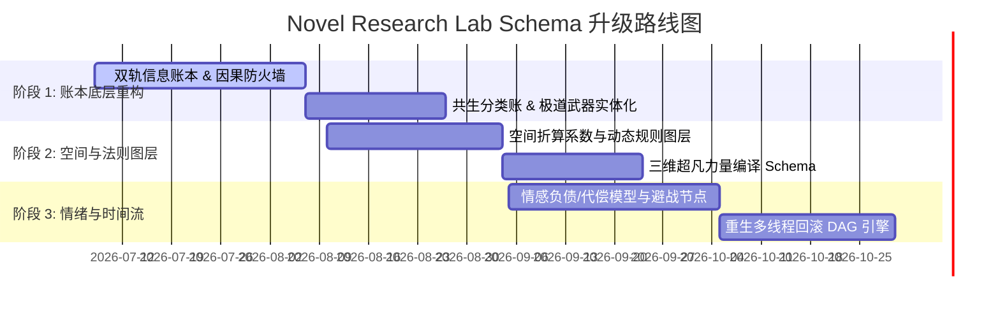

# Novel Research Lab 底层数据模型 Schema Gap 审计报告

* **审计实体**：小说研究实验室 (Novel Research Lab)
* **审计人员**：Agent 8 - 架构审计师 (Schema Auditor)
* **审计基准**：对 7 本标志性网络小说（《人道至尊》、《凡人修仙传》、《斗破苍穹》、《求魔》、《蛊真人》、《诡秘之主》、《遮天》）的阅读分析报告及底层骨架文本
* **审计目标**：识别实验室现有分析模型（Book DNA、Narrative DNA、State Ledger）在表征复杂与商业化网文结构时的底层漏洞（Schema Gaps）、过度约束与缺失子系统，并提出具体的数据模型迭代架构设计。

---

## 一、 执行摘要 (Executive Summary)

小说研究实验室（Novel Research Lab）现有的数字化网文分析模型（Book DNA - 静态特征、Narrative DNA - 叙事结构、State Ledger - 状态账本）在解析复杂的玄幻、仙侠、规则克苏鲁等流派时，暴露出多项根本性的**底层兼容性缺陷（Schema Gaps）**。

传统模型假设世界观是静态的、人物成长是加法的、时间是线性的、人际关系是长线累加的、超凡力量是单纯的数值等级。这种**线性与静态思维**无法准确解构和推演现代高水准商业网文。本审计报告针对上述痛点，系统整理出 3 个维度的模型缺陷，并提出了相应的架构重塑方案，核心包括：**非线性多图层纪元轴**、**基因返祖生理形态矩阵**、**无物理实体共生意识体**、**多轨道马甲因果隔离防火墙**、**双轨信息分层账本**以及**领域级动态规则覆写图层**。

---

## 二、 Book DNA (作品基因) 级别模型缺陷与重构方案

Book DNA 负责存储世界观常数、力量体系框架、历史背景等静态或全局数据。审计发现当前 Schema 存在以下过度约束与盲区：

### 1. 资质负值度量与成长阻力系数缺失 (Aptitude Negativity Metric)
* **现有 Schema 漏洞**：默认主角资质即使平庸，也是“待觉醒的神脉”或“被封印的至尊体”，属于正向资产；无法描述像《凡人修仙传》中韩立这种**纯粹的、物理缺陷且无法修复的“伪灵根”**。
* **Gap 表现**：无法量化修行初期的突破阻力，导致模型在计算越级反杀与“资源换时间”的硬核逻辑时失准。
* **重构方案**：在 Character Template 中引入 `Aptitude_Penalty_Multiplier`（资质惩罚乘数），量化主角相比普通 NPC 破境所需资源（如丹药、灵力）的倍率，用以衡量故事成长线的“硬核/凡人流”属性。

### 2. 闭存量超凡特性与零和博弈约束缺失 (Closed-Loop Conservation Law)
* **现有 Schema 漏洞**：将超凡力量视为“无限供给的灵气系统”或“个人技能树升级”，技能熟练度随修炼线性提升。
* **Gap 表现**：在《诡秘之主》中，高序列非凡特性总量绝对守恒（如序列 1 只有 3 份）。现有的 Schema 无法定义“当主角增加 1 份特性，全球数据库中该特性持有者的最大上限必须自动减 1”的闭环约束，丢失了生态位争夺的底层敌意机制。
* **重构方案**：世界观建模层从单表数据库向**属性图数据库 (Property Graph Database)** 迁移。将非凡特性定义为图中守恒的节点，晋升行为被建模为“节点所有权的零和转移”，自动在有相同晋升需求的 Actor 之间触发不可调和的地缘政治冲突。

### 3. 编译型/软件架构超凡体系表征盲区 (Compiler-Like Power Schema)
* **现有 Schema 漏洞**：力量体系仅记录“技能、伤害值、冷却、消耗”。
* **Gap 表现**：无法建模《蛊真人》中“蛊-杀招-道痕-仙窍”这种类似软件工程的超凡力量体系——缺乏表示“函数级联（蛊虫逻辑拼接）”、“环境寄存器（道痕排斥与加成）”和“硬件负载（仙窍灾劫与容积）”的结构化表征。
* **重构方案**：新增 `Three-Dimensional Power Schema`，分为：
  1. `Resource Layer` (真元/仙元消耗量与纯度)；
  2. `Logic Layer` (杀招的复合函数链拓扑结构，即基础技能的组合逻辑门)；
  3. `Variable Layer` (环境道痕乘数与冲突率因子，作为全局计算修饰符)。

### 4. 跨纪元非线性历史因果账本缺失 (Epoch Causal Ledger Gap)
* **现有 Schema 漏洞**：假设历史是静态背景板，随主角探索而线性展开。
* **Gap 表现**：《遮天》的世界是“非线性历史拼图”，神话、太古、荒古等纪元大帝虽早已故去，但其留下的经文、帝兵与因果在现世疯狂联动。
* **重构方案**：引入 `Epoch Causal Ledger`（多纪元因果账本），允许系统在扫描到历史线索（如帝陵、古籍）时，向历史时间轴进行反向投影，构建非线性的历史事实图谱与因果网。

### 5. 本地与全局战力标尺的汇率偏差 (Spatial Scaling Coefficient Gap)
* **现有 Schema 漏洞**：战力评级使用绝对数值（如战力 1-100）。
* **Gap 表现**：在《斗破苍穹》中，地图转换（如加玛帝国飞升到中州）会导致战力基准剧烈漂移。原先战力 90 的斗皇在新地图变成炮灰，若无相对折算系数，模型会判定战力崩坏。
* **重构方案**：在 Map 节点上挂载 `Spatial_Scaling_Coefficient`（空间折算系数），NPC 威胁度公式重构为：$$\text{Relative Threat} = \frac{\text{NPC Absolute Rank}}{\text{Map Base Line Rank}}$$ 确保战力系统的逻辑连续性。

---

## 三、 Narrative DNA (叙事DNA) 级别模型缺陷与重构方案

Narrative DNA 负责管理大纲走向、情节节点分类与情绪曲线控制。审计发现当前 Schema 的局限如下：

### 1. 情绪振幅、抑扬比与情感负债追踪器缺失 (Emotional Debt Ledger)
* **现有 Schema 漏洞**：仅标记剧情节点类型（如“日常”、“突破”、“战斗”），无法量化情绪。
* **Gap 表现**：在《斗破苍穹》中，憋屈字数规模与反击爽点释放具有黄金比例；在《求魔》中，压抑度与终极代偿构成悲剧升华。现有 Schema 无法进行“情绪负债”与“多巴胺清偿”的动态记账。
* **重构方案**：在 Narrative DNA 中增设 `Emotional Debt Ledger`（情感负债账本）。系统跟踪被打压、羞辱的深度与字数（负债积累），并在高潮点将其清零（清偿），监控负债不超过合理阈值，防范“憋屈致死”导致读者弃书。

### 2. 避战、战术规避与非对抗情节标签缺失 (Evasion Nodes Gap)
* **现有 Schema 漏洞**：大纲生成器只支持“冲突爆发 -> 临战突破 -> 复仇”的经典线性路径。
* **Gap 表现**：在《凡人修仙传》中，面对强敌“韩跑跑”往往选择直接远遁逃跑、设局暗算或绕行，可能在两百章内不作正面回应。传统 Schema 会将此判定为“情节流产/烂尾”。
* **重构方案**：增设 `Anti-Climax Nodes`（反高潮/避战节点）与 `Tactical Evasion Tracks`，允许大纲模型在检测到高阶风险时，自动生成“避战遁走、绕行、信息误导”的情节分支，并对“名誉受损值”与“生命安全增量”进行双向记账。

### 3. 地图转换时的社会关系强解耦机制缺失 (Decoupled Map Transition Reset)
* **现有 Schema 漏洞**：默认建立长线、连贯的人物关系图谱。
* **Gap 表现**：以《凡人修仙传》为代表的凡人流网文，其核心叙事具有“胶囊化切换”特征——飞升或换海域即重置社会关系，原有的宗门、仇敌在几百章内完全物理隔离。
* **重构方案**：引入 `Map Transition Capsule Class`（叙事胶囊类）。当触发跨图事件时，系统自动对旧地图的 State Ledger 人际关系网进行“归档隔离”，开启崭新的“生存开荒模板”，限制旧人际资产在未触发因果回响线时的调用。

### 4. 非线性多时间线 DAG 与世界线回滚盲区 (Timeline-Forking DAG Schema)
* **现有 Schema 漏洞**：设定时间为单线线性流逝。
* **Gap 表现**：《蛊真人》中方源使用春秋蝉自爆重生，时间线转化为 Directed Acyclic Graph (DAG) 分叉模型。世界重置为过去的 savepoint，但特定 Agent 的 memory 与 karma 必须作为不变量跨时间线继承。
* **重构方案**：剧情引擎开发 `Cross-timeline State Storage`，在世界回滚时保留特定主角的载荷（Memory Payload），支持对重生套利效益的量化评估。

### 5. 第三方震惊指数与旁观者增幅器缺失 (Bystander Reaction Index)
* **现有 Schema 漏洞**：震惊的路人仅被分类为“背景 NPC”或普通的“对话参与者”。
* **Gap 表现**：在《斗破苍穹》等经典爽文中，“围观群众/老祖级配角”是情绪的放大器（俗称“弹幕爽感增幅器”）。丢失震惊指数会导致模型无法量化爽点爆发的乘数效应。
* **重构方案**：引入 `Bystander Reaction Index`（旁观者反应指数）。根据围观者的级别（Combat Rank）、震惊的广度与解释深度，乘数化高潮爽点的多巴胺释放值。

### 6. 因果回响与跨时空情感继承线的缺失 (Karmic Threading Gap)
* **现有 Schema 漏洞**：实体关系模型仅定义直接关系（如师徒、仇敌）。
* **Gap 表现**：《遮天》中的“相似的花”和狠人大帝对叶凡跨越百万年的庇护，是基于红尘回响的因果线。缺乏此类 Schema 会导致系统误判天花板强者保护主角的内在动机。
* **重构方案**：在关系图谱中新增 `similar_flower_of` 和 `emotional_inheritance_from` 关系，在不同时代的实体 ID 之间拉起跨时空的 `Karma Line`，以推导因果庇护逻辑。

---

## 四、 State Ledger (状态账本) 级别模型缺陷与重构方案

State Ledger 用于实时跟踪主角与外部世界实体的参数状态。审计发现以下核心 Gap：

### 1. 信息暴露分层与双轨信息账本缺失 (Information Exposure Mask & Dual-Track Ledger)
* **现有 Schema 漏洞**：全局仅维护一份公开的、外界与主角达成一致的实体属性列表。
* **Gap 表现**：《凡人修仙传》等谨慎修真文中，主角通过敛气术、马甲（如厉飞雨）和法宝隐匿真实修为。Public 状态（筑基、凡铁飞剑）与 True 状态（元婴、掌天瓶、噬金虫）存在巨大鸿沟。
* **重构方案**：将 State Ledger 重构为双轨视图：
  1. `Public View` (公开掩码层)：NPC 可探查的数据；
  2. `True View` (真实暗箱层)：主角的真实底牌。
  并引入信息不对称度公式，用于自动预测低调反杀率：
  $$\text{Asymmetry Ratio} = 1 - \frac{|\text{Public View} \cap \text{True View}|}{|\text{True View}|}$$

### 2. 共生意识体与灵魂空间共享实体建模缺失 (Symbiotic Co-habitation Actor Gap)
* **现有 Schema 漏洞**：所有 `Actor` 必须有独立的外部物理坐标。
* **Gap 表现**：在《人道至尊》中，“薪火”寄生于主角识海，没有独立的物理坐标。它与主角共享五感、有独立意志和记忆，甚至能在特定危机下被主角“授权”代管肉身。
* **重构方案**：在 State Ledger 中定义 `Symbiotic Actor Ledger`（共生体分类账）。挂载于 Host 实体的识海节点，共享传感器输入（Sensory Input），拥有独立的 `willpower_index` 与 `action_permission_mask`（授权代管掩码）。

### 3. 多重马甲的声望分裂与因果防火墙缺失 (Multi-Persona Karma Firewall)
* **现有 Schema 漏洞**：仅支持别名（Aliases）标记，声望和阵营敌意值全局统一。
* **Gap 表现**：《人道至尊》中主角的马甲“易先生”为天庭重臣（信任值 90），本体“龙岳/钟岳”为伏羲叛逆（敌意值 100）。若无隔离防火墙，系统将无法理清“易先生领兵剿灭钟岳”这种信息差政争逻辑。
* **重构方案**：在 Ledger 中允许一个 UUID 挂载多个并行的 `Narrative_Profile`。每个 Profile 拥有独立的声望、社交网与可见性掩码。增设 `Karma Firewall`（因果防火墙），只有在特定马甲掉落事件触发时，才执行 Profile 之间的属性与仇恨值归并。

### 4. 领域级动态法理覆写图层的建模缺陷 (Macro-Domain Law Constrainer)
* **现有 Schema 漏洞**：地图节点仅支持静态地理拓扑连接和静态等级限制。
* **Gap 表现**：无法表征由大事件触发的局部世界运行法则修改。例如《人道至尊》中“泰山封禅血”强制将所有降临大荒的神魔削为凡血人族，或《遮天》中生命禁区对宇宙大道的剥离。
* **重构方案**：地图 Schema 增加 `active_world_laws` 属性图层。当地图节点发生规则覆写事件时，向该地理范围广播 `Rule_Modifier`（规则修饰符），动态修改此区域内所有 Actor 的战力判定公式（如：`if location == 'Ancestral_Star': max_divine_power = 0`）。

### 5. 认知真实度偏差与主客观分类账的缺失 (Reality Discrepancy Index)
* **现有 Schema 漏洞**：仅记录客观世界发生的数据。
* **Gap 表现**：在《求魔》中，苏铭的前期记忆完全是人造的谎言。如果 Ledger 无法同时记录主观状态与真相状态，就无法量化真相揭露时产生的绝望与戏剧张力。
* **重构方案**：Ledger 支持 `Subjective Sub-ledger`（主观账本）与 `Objective Sub-ledger`（客观账本），计算 `Cognitive Discrepancy Index`（认知偏差度）。并配合 `Reality Horizon Tracker`（叙事现实水平线追踪器）追踪梦境、幻境、现实等多重嵌套容器间的属性记忆穿透。

### 6. 神奇道具与封印物“触发式负效应动作”的缺失 (Negative Trigger Action Register)
* **现有 Schema 漏洞**：道具（Inventory Items）仅能提供正向属性增益（如加攻击、加防御）。
* **Gap 表现**：在《诡秘之主》中，每个神奇物品和封印物均挂载强烈的、甚至致死性的负效应规则（如必须按时喂血、随时可能吸干持有者、夜间使用触发邪神低语）。
* **重构方案**：在 Item Entity 中引入 `Negative Trigger Action Register`（负效应动作寄存器），与场景生成器的决策堆栈联动。在战斗或探索中，引擎自动检索并强制生成封印物负效应相关的应对情节，提高硬核智斗的约束度。

### 7. 极道武器实体化与“Proxy-NPC”建模缺失 (Sentient Weapon Actor)
* **现有 Schema 漏洞**：法宝被降维归类为 Inventory 里的静态死物。
* **Gap 表现**：在《遮天》中，极道帝兵（如虚空镜、恒宇炉）拥有独立的情感、大道记忆与复苏状态，是能作为“历史继承人/代理人”的实体。
* **重构方案**：将 Sentient Artifact 从 Item 升级为 `Entity`，赋予其 `Will_Strength` (自主意志强度)、`Awakening_State` (觉醒状态机) 以及 `Causal_Owner_Ids` (历代主人因果继承链)。

---

## 五、 总结与模型整合路线图 (Integration Roadmap)

为了将上述 Gap 审计结果转化为具体的产品能力，小说研究实验室的架构升级工作将分为以下三个阶段进行：

### 1. 阶段 1：状态账本底层重构 (Ledger Core Refactoring)
* **目标**：解决“双轨马甲声望隔离”、“信息不对称”和“多意志共生体”的硬性建模问题。
* **交付件**：在 `State Ledger` 中增加 `Narrative_Profile` 分区与 `Karma_Firewall` 逻辑阀；在角色实体中增加 `genetic_structure` 返祖矩阵。

### 2. 阶段 2：空间拓扑与法则覆写 (Spatial & Law Overlays)
* **目标**：解决“换地图战力崩溃”和“领域法则强制重载”的问题。
* **交付件**：升级地图拓扑 Schema，在 Map 节点引入 `Spatial_Scaling_Coefficient` 与 `active_world_laws` 动态图层；为神奇物品和力量设计“负效应动作寄存器”与“力量编译组合逻辑门”。

### 3. 阶段 3：情绪控制与时间回滚 (Emotional & Temporal Algorithms)
* **目标**：量化“憋屈-爽点抑扬比”和“多线程回档重生”的剧情走势。
* **交付件**：在 Narrative DNA 中部署 `Emotional Debt Ledger` 计算公式与 `Timeline-Forking Engine` 线程回滚算法，最终实现高格调、高智商商业网文的自动化高保真推演与生成。
