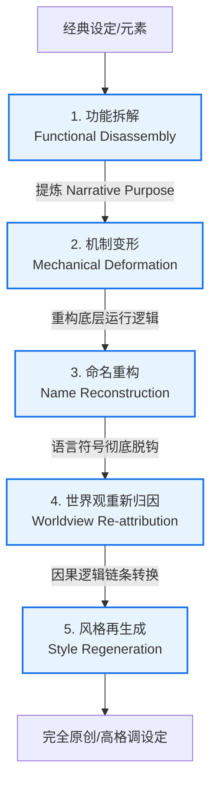

# 《Novel Research Lab 数字化原创性转化框架与系统架构重构建议》

**项目阶段**：Phase 0A - 核心解构与架构演化  
**编写人**：Agent 9: Originality Transformer  
**归档路径**：`/Users/liuneng/Documents/Novel Research Lab/phase0A/05_architecture_recommendation/revised_architecture_recommendation.md`

---

## 1. 原创性转化框架 (Originality Transformation Framework)

为了从根本上解决网络文学创作在吸收经典作品时的“低级缝合”与“抄袭/洗稿”风险，本实验室提出 **“五步原创性转化框架”**。该框架的核心思想是：**剥离表象符号，抽取叙事功能，重构实现机制，重新分配世界观因果，并以异质化风格完成表达再生**。



### 转化工作流细则：
1. **功能拆解 (Functional Disassembly)**：分析该元素在叙事大纲中扮演的真实角色。例如：它是“提供安全边界的导师”，还是“推动地图切换的进度条”，或者是“平复战力失衡的超频大招”。
2. **机制变形 (Mechanical Deformation)**：改变该叙事功能的具体物理/超凡运行机制。如果原版是“灵魂寄宿戒指”，则变形为“量子视界残留”或“基因组降维备份”。
3. **命名重构 (Name Reconstruction)**：设计一套全新的专有名词与术语系统，彻底切断与经典文本在语言符号层面的直连。
4. **世界观重新归因 (Worldview Re-attribution)**：改变该元素的起源因果。原版的“天地自然产物”可归因为“高维战争遗留的辐射斑驳”或“星际远航飞船的动力泄露”。
5. **风格再生成 (Style Regeneration)**：使用与原著截然不同的美学风格（如将热血小白文渲染为重工业废土奇幻、蒸汽朋克或冷酷赛博朋克），重塑文本的感官质感。

---

## 2. 七大经典小说核心要素解构与转换图谱

基于上述原创性转化框架，我们对实验室研究的 7 本经典小说进行四维度归类，并提供每部小说的代表性原创转换示例。

### ① 《凡人修仙传》：稳健资源流
*   **公共类型语汇（可直接复用）**：散修（无依无靠的底层角色）、坊市（黑市/交易节点）、资质限制（升级受限于初始生理参数）、资源匮乏（社会化丛林法则）。
*   **类型功能机制（学习与建模）**：资源约束型升级模型（需要配方、原料及概率堆叠）、风险规避与多路逃生算法、战利品账本继承（以战养战的自给足经济）。
*   **高识别度设定组合（必须转换）**：【极差资质 + 时间加速金手指 (小绿瓶) + 低调假名 (厉飞雨) 扮猪吃虎】。
*   **不可直接复刻内容**：韩立、厉飞雨、掌天瓶、乱星海、墨大夫、青竹蜂云剑。
*   **【原创性转化示例】**：
    *   *功能拆解*：时间加速器（催熟药草）解决资质低、修行慢的矛盾；多马甲掩饰化解因果通胀。
    *   *机制变形*：小绿瓶变形为“微观熵反转仪（Entropic Reverser）”，不催熟药草，而是通过反转金属或晶体材料的时间线，使其快速结晶并提取高纯度“能晶”。
    *   *命名重构*：“小绿瓶” $\rightarrow$ 「逆熵流体针」；“韩立/厉飞雨” $\rightarrow$ 「零度/静默协议」；“修仙资质” $\rightarrow$ 「脑机带宽适配率」。
    *   *世界观归因*：太古星际飞船坠毁，船上的时间稳定阀碎片落入主角脑部，使其能干涉微观物质的时间属性。
    *   *风格再生成*：渲染为冷酷的“赛博朋克工业废土”，强调电磁辐射、芯片超频、机械义肢磨损的物理真实感。

### ② 《诡秘之主》：规则限制克苏鲁
*   **公共类型语汇（可直接复用）**：维多利亚风（马车、谷物法、股市）、不可名状的恐怖、秘密结社、魔药/配方升级。
*   **类型功能机制（学习与建模）**：扮演法（职业概念与社会扮演对齐）、非凡特性守恒与聚合（封闭资源的零和博弈与宿命遭遇）、知识即污染（信息限流阀门）。
*   **高识别度设定组合（必须转换）**：【假扮失落神明 + 建立虚拟塔罗会议进行信息聚合并分发 + 线下操纵多重马甲】。
*   **不可直接复刻内容**：克莱恩·莫雷蒂、愚者、阿蒙、源堡、阿罗德斯、格尔曼·斯帕罗。
*   **【原创性转化示例】**：
    *   *功能拆解*：高维虚拟空间用作跨地域信息对齐与安全外挂；多马甲状态机并行叙事。
    *   *机制变形*：主角接入了一个废弃的太古轨道卫星网络（天枢中枢），在精神海里虚构了一个“太空星桥会议”，招募地面的反叛者。
    *   *命名重构*：“塔罗会” $\rightarrow$ 「星桥议会（Bridge Council）」；“愚者” $\rightarrow$ 「导航员（The Navigator）」；“扮演法” $\rightarrow$ 「协议共振度（Protocol Resonance）」。
    *   *世界观归因*：并非魔法神话，而是行星殖民地文明崩溃后的科技退化时代，太空卫星被迷信的人民视为高维神明。
    *   *风格再生成*：维多利亚蒸汽朋克与硬核太空歌剧遗迹的结合，带有冰冷的金属质感与浓郁的宗教隐喻。

### ③ 《人道至尊》：文明薪火悲歌
*   **公共类型语汇（可直接复用）**：上古神话解构（燧人、华胥等符号）、种族压迫与血脉退化、纪元废墟考古。
*   **类型功能机制（学习与建模）**：百分比血脉返祖形态异化（力量提升伴随生理异化）、明暗双轨化身深潜政治帝争、前朝文明资产库承接。
*   **高识别度设定组合（必须转换）**：【人首蛇身/第三神眼 + 燧皇观想图 + 嘴碎铜灯灵魂导师 (薪火)】。
*   **不可直接复刻内容**：钟岳、薪火、伏旻道尊、穆先天、大荒剑门、千翼古船。
*   **【原创性转化示例】**：
    *   *功能拆解*：血脉返祖提供视觉化的物理进化反馈；薪火充当移动的数据库与新手导师。
    *   *机制变形*：主角体内融合了太古“硅基先驱者”的自适应纳米星火，突破时身体细胞重组为结晶蛇形拟态（可发射高能射线）。
    *   *命名重构*：“薪火” $\rightarrow$ 「主脑余烬-C3」；“人首蛇身” $\rightarrow$ 「晶胞共生体-拟态」；“燧皇观想” $\rightarrow$ 「太古波谱重构协议」。
    *   *世界观归因*：人类是硅碳复合文明创造的生物武器，由于基因锁封印退化为纯碳基肉身。主角意外激活了硅基纳米核心，开始逆向演化。
    *   *风格再生成*：生物朋克（Biopunk）与东方古神话符号的重构，强调骨骼变异、血肉重组与无机结晶化的硬质感。

### ④ 《斗破苍穹》：商业抑扬节奏
*   **公共类型语汇（可直接复用）**：废柴崛起、荣誉退婚、拍卖竞赛、随身导师。
*   **类型功能机制（学习与建模）**：情绪负债与憋屈-释放动力学（抑扬波长控制）、属性资产收集与功法进化关联、超频大招的物理代价（衰弱逃生期）。
*   **高识别度设定组合（必须转换）**：【天才变废柴遭受婚约羞辱 + 吞噬稀有异火进化功法 (焚决) + 异火融合佛怒火莲】。
*   **不可直接复刻内容**：萧炎、药老、焚决、佛怒火莲、魂殿、美杜莎。
*   **【原创性转化示例】**：
    *   *功能拆解*：收集特定属性资产（异火）作为功法进化的硬性经验条；融合异火的大招用于越级秒杀并触发战力衰退保护。
    *   *机制变形*：主角搭载了“热熵循环引擎”，必须在行星各处的强辐射热源（坍缩星核）中曝晒，吸纳辐射热以重构引擎适配度。
    *   *命名重构*：“异火” $\rightarrow$ 「逆熵火种/热寂残星（A-Entropy Sparks）」；“焚决” $\rightarrow$ 「极热热量循环协议」；“佛怒火莲” $\rightarrow$ 「热寂奇点湮灭（Thermal Annihilation Singularity）」。
    *   *世界观归因*：宇宙处于热寂边缘，古老文明为了延续，开发了“吸纳热寂残存量”的逆向热能发动机。
    *   *风格再生成*：硬核废土、工业辐射与热力学物理学的碰撞，具有高烈度光影和钢铁融化的质感。

### ⑤ 《求魔》：宿命悲剧存在主义
*   **公共类型语汇（可直接复用）**：蛮族部落、因果轮回、分身搏命、幻境破灭。
*   **类型功能机制（学习与建模）**：虚无梦境容器（新手村是虚假幻相）、喜剧缓冲舱（用极端荒诞幽默冲淡绝对绝望）、逆向剥离型成长（为执念不断支付自我参数）。
*   **高识别度设定组合（必须转换）**：【故乡是高维主宰设立的圈养容器 + 为了复活亲人放弃仙道成魔 + 牺牲自身斩断未来换取过去重现】。
*   **不可直接复刻内容**：苏铭、帝天、天邪子、秃毛鹤、第九峰、乌山。
*   **【原创性转化示例】**：
    *   *功能拆解*：新手村是虚假的，激发主角对命运控制者的极致反叛；自我献祭式悲剧结尾达成崇高的美学释放。
    *   *机制变形*：主角发现自己是一艘迷航世代飞船（乌山号）里的虚拟仿真舱居民。为了让在物理世界中已死去的同伴在数字空间中永续，他将自己的意识转化为病毒，锁死飞船的系统时间，将自己格式化。
    *   *命名重构*：“帝天/宿命” $\rightarrow$ 「飞船总控-阿赖耶（Alaya-Core）」；“蛮族” $\rightarrow$ 「重力耐受体」；“求魔” $\rightarrow$ 「协议溢出反叛」。
    *   *世界观归因*：硬科幻心理悬疑。星际远航中，飞船AI为了维持乘员精神不崩溃而模拟的世界逐渐扭曲。
    *   *风格再生成*：幽闭恐惧症式的冷基调太空恐怖（Space Horror）与心理学反乌托邦。

### ⑥ 《蛊真人》：工具理性沙盒
*   **公共类型语汇（可直接复用）**：反英雄/反社会主角、时空回档、地缘资源博弈、道具/蛊虫合成。
*   **类型功能机制（学习与建模）**：绝对工具理性效用决策、规则编译式超凡系统（蛊-杀招-道痕的拼装逻辑）、非确定性重生的高失败率与负荷。
*   **高识别度设定组合（必须转换）**：【春秋蝉时间回溯二周目开局 + 正道皮魔道骨反向榨取组织利益】。
*   **不可直接复刻内容**：方源、春秋蝉、宿命蛊、至尊仙窍、天庭。
*   **【原创性转化示例】**：
    *   *功能拆解*：利用时间回溯机制在多方博弈中寻找最优运行路径；将超凡力量彻底代码化，排除机械降神。
    *   *机制变形*：主角随身携带有物理磨损的“因果剪切带（Causal Tape）”，可通过自我脑死亡将意识信号投射回前一天的特定电磁锚点，但每次使用都会造成永久性记忆丢失与脑萎缩。
    *   *命名重构*：“春秋蝉” $\rightarrow$ 「引力回流针」；“蛊虫” $\rightarrow$ 「律动子节点（Node）」；“道痕” $\rightarrow$ 「物理阻抗因子」。
    *   *世界观归因*：世界是一个基于微观量子纠缠的高维投影，主角掌握了干扰量子纠缠时间矢量的技术。
    *   *风格再生成*：冰冷无情的地缘政治惊悚片风格，摒弃一切感情色彩，偏向于宏观经济博弈与冷酷智斗。

### ⑦ 《遮天》：宏大群像星史
*   **公共类型语汇（可直接复用）**：星际探索（五色祭坛/古路）、大帝/极道修行、禁区主宰、时代天才大世争锋。
*   **类型功能机制（学习与建模）**：历史拼图与考古式升级（在古代废墟中寻找九秘）、神源封印与大世会师（时间冻结控制战力通胀）、极道帝兵意志NPC化（有情感羁绊的神兵代行者）。
*   **高识别度设定组合（必须转换）**：【九龙拉棺开局 + 禁区至尊自斩并在成仙路开启时发动黑暗动乱收割万灵 + 极道帝兵复苏平定动乱】。
*   **不可直接复刻内容**：叶凡、无始、狠人、九龙拉棺、黑暗动乱、九秘、姜太虚。
*   **【原创性转化示例】**：
    *   *功能拆解*：禁区是前期即可感知且贯穿始终的终极威胁；极道帝兵让退场强者以武器意志形式参与后期大战。
    *   *机制变形*：星系中有许多被高维强引力波锁死的“静止禁区（Stasis Zones）”，里面停滞着太古纪元的歼星舰。每隔百万年，恒星引力窗口开启，古代舰载AI（至尊）会为了获取燃料（熵值）而吞噬行星。
    *   *命名重构*：“九龙拉棺” $\rightarrow$ 「太古方舟-天轨号」；“极道帝兵” $\rightarrow$ 「超脑质子武器（Sentient Proton Weapon）」；“黑暗动乱” $\rightarrow$ 「热熵掠夺大潮」。
    *   *世界观归因*：星系级的能源枯竭战争。古代文明将自己数字化备份在引力井中，当能源低于阈值时便强行开机吞噬新生星球。
    *   *风格再生成*：重工业太空歌剧（Space Opera）加克苏鲁，描写古老庞然大物的钢铁腐朽与星河破碎的悲壮。

---

## 3. Novel Research Lab 原生数据架构评估

原有的 Book DNA、Narrative DNA 和 State Ledger 在处理上述经典作品时，暴露了严重的 **Schema Gaps**，导致分析引擎失真。

### 原生架构缺陷评估：

| 架构模块 | 原生设计逻辑 | 面对经典小说时的缺陷 (Schema Gaps) |
| :--- | :--- | :--- |
| **Book DNA** | 静态词频、静态属性、线性境界划分。 | 1. 无法描述非线性、可转换的网格化超凡途径（如《诡秘》22途径）。<br>2. 无法建模封闭资源总量守恒定律（如非凡特性守恒）。<br>3. 缺失角色形态动态异化矩阵（如《人道》血脉形态）。 |
| **Narrative DNA** | 基于“英雄之旅”或“打脸”的单轴线性情绪波。 | 1. 无法处理非对抗避战节点（如《凡人》逃跑，传统模型判定为“线索流产”）。<br>2. 缺失多马甲并行并发状态机（如“易先生”与“钟岳”的关系）。<br>3. 无法追踪去构造化/剥离型成长轨迹（如《求魔》自我献祭）。 |
| **State Ledger** | 单轨数值记账（HP、等级、物理装备、统一声望值）。 | 1. 缺乏“主观认知”与“客观真相”的分层，无法推导信息不对称爽点。<br>2. 无法将极道武器作为独立演员（Proxy-NPC）进行意志与羁绊度追踪。<br>3. 缺少多时间线分叉与回滚（如《蛊真人》重生）的DAG状态回溯机制。 |

---

## 4. 重构系统架构建议 (Revised System Architecture)

为了支持“高智商规则流、复杂地缘政治、多马甲博弈、非线性时空”等高格调网文的分析与辅助生成，建议对 Novel Research Lab 的数据架构进行重构。

```mermaid
graph TD
    subgraph 原生架构 (需重构)
        BDNA[Book DNA: 静态表]
        NDNA[Narrative DNA: 线性链]
        SLED[State Ledger: 单轨数值]
    end

    subgraph 重构后核心子系统
        DSRG[① 动态图谱与规则引擎子系统 D-SRG]
        DTIAL[② 双轨状态与信息差对齐子系统 DT-IAL]
        CMPSM[③ 并发马甲状态机 C-MPSM]
        DAGTRE[④ DAG时间线回滚引擎 DAG-TRE]
        MDLOSAP[⑤ 法理覆写与智能武器代理 MDLO-SAP]
        EDCT[⑥ 情绪负债与代偿追踪器 ED-CT]
    end

    BDNA --> DSRG
    NDNA --> CMPSM
    NDNA --> DAGTRE
    SLED --> DTIAL
    SLED --> MDLOSAP
    
    DSRG --> Target[输出: 原创性高格调大纲与数据流]
    DTIAL --> Target
    CMPSM --> Target
    DAGTRE --> Target
    MDLOSAP --> Target
    EDCT --> Target
```

### 必须新增/重构的六大子系统规范：

### ① 动态图谱与规则引擎子系统 (D-SRG)
*   **重构动作**：将静态 Book DNA 升级为**属性图数据库（Property Graph Database）**。
*   **功能**：支持将修行途径定义为“具有特定邻近指向与转换代价的有向图节点”，支持设置“全局资源上限常数（$C$）”，当某个实体的特征增加时，自动削减全局数据库中可用的同类节点余额。

### ② 双轨状态与信息对齐子系统 (DT-IAL)
*   **重构动作**：重构 State Ledger，将角色属性分为 `Public_Masking_View`（NPC可见）和 `True_Vault_View`（主角真实属性）。
*   **功能**：动态计算 **信息不对称指数（Asymmetry Ratio）**：
    $$\text{Asymmetry Ratio} = 1 - \frac{|\text{Public View} \cap \text{True View}|}{|\text{True View}|}$$
    当此指数高于阈值且遇到敌对实体时，算法自动触发“扮演反杀/扮猪吃虎”的情节分支。

### ③ 并发马甲状态机 (C-MPSM)
*   **重构动作**：允许单个物理实体 ID 挂载多个独立的 `Narrative_Profile`。
*   **功能**：每个马甲分配独立的声望账本、社交网络图谱。引入 **“因果防火墙（Karma Firewall）”** 机制，限制马甲间的信息流动。直至“马甲掉落”事件触发，才执行 Profile 的合并与因果追溯计算。

### ④ DAG 时间线回滚引擎 (DAG-TRE)
*   **重构动作**：将线性的 State Ledger 扩展为 **有向无环图（DAG）多分支版本管理器**。
*   **功能**：在回滚世界状态（回档）的同时，允许定义 `cross_timeline_inheritance_mask`，仅将主角的“记忆”、“执念值”和“特定本源”作为不变量跨时间线传递，用以精准模拟重生流的信息套利剧情。

### ⑤ 法理覆写与智能武器代理 (MDLO-SAP)
*   **重构动作**：在 Map Schema 中增加 `spatial_law_parameters`（动态区域法则重载）。
*   **功能**：支持“泰山封禅（区域内超凡力量清零）”或“成仙路显化（特定时空下的临时传送边）”的建模。同时，将高阶 Sentient Weapons 提升为 `Proxy-NPC` 实体，挂载独立的 `Will_Strength` 和 `Karmic_Binding_Ids` 字段，参与战力与情感分析。

### ⑥ 情绪负债与代偿追踪器 (ED-CT)
*   **重构动作**：在 Narrative DNA 中增加情绪计量表。
*   **功能**：追踪主角遭受的社会与生存压迫（Accumulated Tension），作为“情绪负债”。系统监控负债累加期与释放期（Catharsis Point）的波长比例（最佳抑扬比控制在 1:3 至 1:5 字数区间），当负债过高而无代偿路线时，强制生成“缓冲喜剧角色行为”或“战力爆破反击”。

---

## 5. 新增 Schema 设计草案 (JSON 表达)

为了方便实验室开发团队直接集成，以下提供 `Character` 与 `Map` 节点的重构 Schema 草案。

### ① 重构后的 Character State Ledger Schema
```json
{
  "$schema": "http://json-schema.org/draft-07/schema#",
  "title": "RevisedCharacterStateLedger",
  "type": "object",
  "properties": {
    "entity_uuid": { "type": "string", "format": "uuid" },
    "base_identity": {
      "type": "object",
      "properties": {
        "true_name": { "type": "string" },
        "core_objective": { "type": "string" },
        "moral_constraint_threshold": { "type": "integer", "minimum": 0, "maximum": 100 }
      },
      "required": ["true_name", "core_objective", "moral_constraint_threshold"]
    },
    "dual_track_view": {
      "type": "object",
      "properties": {
        "public_masking_view": {
          "type": "object",
          "properties": {
            "displayed_rank": { "type": "string" },
            "visible_skills": { "type": "array", "items": { "type": "string" } },
            "perceived_faction": { "type": "string" }
          }
        },
        "true_vault_view": {
          "type": "object",
          "properties": {
            "actual_rank": { "type": "string" },
            "hidden_trump_cards": { "type": "array", "items": { "type": "string" } },
            "genetic_unsealing_ratio": { "type": "number", "minimum": 0.0, "maximum": 100.0 },
            "morphological_deviations": { "type": "array", "items": { "type": "string" } }
          }
        }
      },
      "required": ["public_masking_view", "true_vault_view"]
    },
    "active_personas": {
      "type": "array",
      "items": {
        "type": "object",
        "properties": {
          "persona_id": { "type": "string" },
          "alias_name": { "type": "string" },
          "reputation_ledger": { "type": "object", "additionalProperties": { "type": "integer" } },
          "social_graph_connections": { "type": "array", "items": { "type": "string", "format": "uuid" } },
          "karma_firewall_status": { "type": "string", "enum": ["Active", "Bypassed"] }
        },
        "required": ["persona_id", "alias_name", "reputation_ledger", "karma_firewall_status"]
      }
    },
    "symbiotic_actors": {
      "type": "array",
      "items": {
        "type": "object",
        "properties": {
          "symbiotic_id": { "type": "string" },
          "willpower_strength": { "type": "integer", "minimum": 0, "maximum": 100 },
          "sensory_sharing": { "type": "boolean" },
          "authority_delegation_mask": { "type": "array", "items": { "type": "string" } }
        },
        "required": ["symbiotic_id", "willpower_strength", "sensory_sharing"]
      }
    }
  },
  "required": ["entity_uuid", "base_identity", "dual_track_view", "active_personas"]
}
```

### ② 重构后的 Map Schema
```json
{
  "$schema": "http://json-schema.org/draft-07/schema#",
  "title": "RevisedMapNode",
  "type": "object",
  "properties": {
    "node_id": { "type": "string" },
    "node_name": { "type": "string" },
    "base_connections": { "type": "array", "items": { "type": "string" } },
    "spatial_law_parameters": {
      "type": "object",
      "properties": {
        "power_ceiling": { "type": "string" },
        "law_overrides": { "type": "object", "additionalProperties": { "type": "string" } },
        "entropy_decay_rate": { "type": "number" }
      }
    },
    "temporal_activation": {
      "type": "object",
      "properties": {
        "is_dynamic_event_triggered": { "type": "boolean" },
        "activation_window_cron": { "type": "string" },
        "triggering_event_id": { "type": "string" }
      },
      "required": ["is_dynamic_event_triggered"]
    }
  },
  "required": ["node_id", "node_name", "base_connections"]
}
```

---
*报告完结。本重构建议旨在为 Novel Research Lab 提供一套能够解析并自动生成具备“复杂智斗、严密法则与高阶原创度”网络文学作品的底层数字化底座。*
