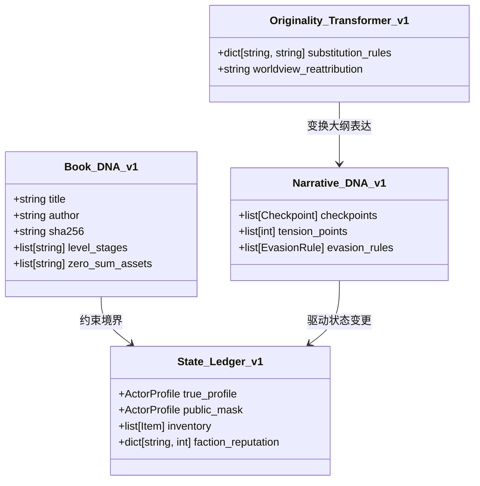

# Phase 0B 准入决策与最小可行架构蓝图 (Entry Decision & MVA Blueprint)

本报告正式给出 Novel Research Lab 从 Phase 0A.5 迈向 Phase 0B 的准入决策，并勾勒出 v1.0 最小可行架构（Minimum Viable Architecture, MVA）的技术蓝图。

---

## 1. 准入决策 (Go/No-Go Verdict)

> [!IMPORTANT]
> **决策结论：批准准入 (GO)**  
> 鉴于 Phase 0A.5 已经成功将上一阶段过度设计的复杂度进行了**收敛与裁剪**（剔除了 DAG 重生引擎、帝兵 Actor 化、动态法则覆写图层等高成本模块），目前的架构设计已精简至“可执行、可闭环”的 MVP 范围。因此，判定**立刻可以进入 Phase 0B 进行架构冻结**。

---

## 2. v1.0 最小可行架构蓝图 (MVA Blueprint)
v1.0 的数据模型将由以下四大模块组成，均以轻量级 JSON 格式存储和读取，排除图数据库及动态公式计算依赖。



### ① Book DNA (世界与规则静态基因)
*   **境界序列 (Level Sequences)**：
    ```json
    {
      "level_stages": ["练气", "筑基", "结丹", "元婴", "化神"]
    }
    ```
*   **存量上限约束 (Cap Constraints)**：
    ```json
    {
      "zero_sum_assets": [
        {"asset_name": "逆熵火种", "max_global_slots": 1, "owner": "true_actor_uuid"}
      ]
    }
    ```

### ② Narrative DNA (极简叙事大纲)
*   **避战决策节点 (Evasion Checkpoints)**：
    ```json
    {
      "checkpoints": [
        {
          "node_id": "c_003",
          "title": "遭遇极阴老祖",
          "tension": -8,
          "is_combat_skippable": true,
          "evasion_action": "启动敛气术遁往乱星海"
        }
      ]
    }
    ```

### ③ State Ledger (双轨掩码分层账本)
*   **主观掩码与客观真实 (True vs Mask Profile)**：
    ```json
    {
      "true_profile": {
        "name": "韩立",
        "level": "筑基中期",
        "power_score": 850
      },
      "public_mask": {
        "name": "厉飞雨",
        "level": "炼气期七层",
        "power_score": 150
      }
    }
    ```
*   **资产与反噬代价 (Inventory & Cost)**：
    ```json
    {
      "inventory": [
        {
          "item_name": "远古冷凝器",
          "type": "alchemy_tool",
          "backlash_desc": "每次催熟灵药需消耗主人 10% 气血"
        }
      ]
    }
    ```

### ④ Originality Transformer (机制原创映射器)
*   **词汇与因果归因静态替换字典**：
    ```json
    {
      "substitution_rules": {
        "掌天瓶": "太古热熵冷凝结晶",
        "韩立": "林寻",
        "异火": "引力微奇点",
        "佛怒火莲": "引力奇点塌陷湮灭"
      },
      "worldview_reattribution": "将修真界的天地灵气归因于远古超维度文明降维产生的辐射残留。"
    }
    ```

---

## 3. Phase 0B 冻结阶段的核心任务
进入 Phase 0B 后，团队将主要集中精力锁定以下两项资产，不得再引入任何新需求：
1.  **锁定最终的 JSON Schema 协议定义**：完成上述四大 MVA 模块的精确 JSON schema 规范，并进行格式校验。
2.  **跑通极简大纲转化 Demo**：手动输入 1 个经典桥段（如“韩立杀人夺宝遁走”），经 MVA 架构脱敏后，成功生成第一章原创小说正文，作为 Phase 0 结项的最终验收标准。
