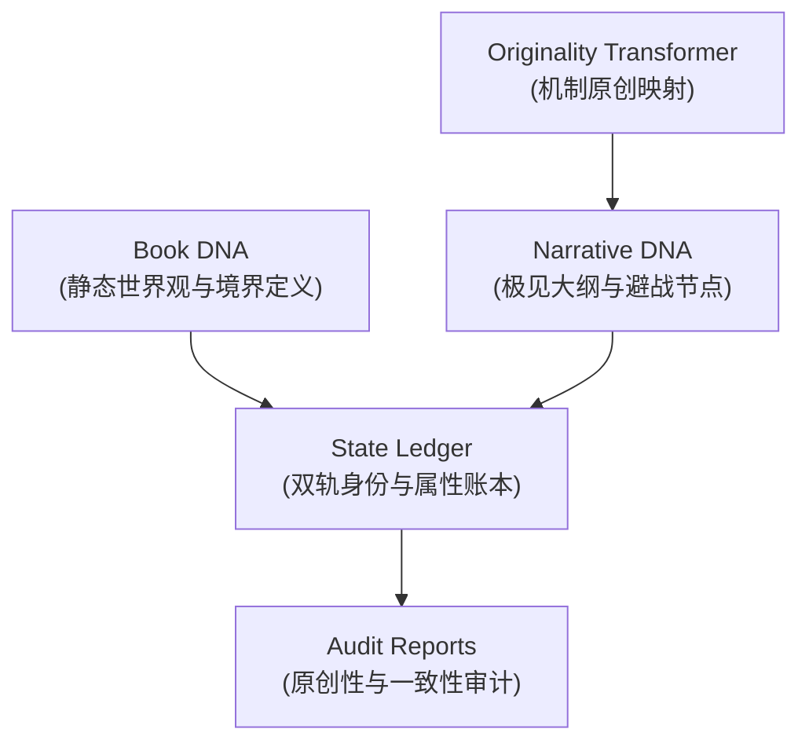

# Novel Research Lab v1.0 系统架构设计书 (Architecture Spec)

本规范书定义了 Novel Research Lab v1.0 的最小可行架构（MVA）。整个系统由五个解耦的数据子系统与数据通道组成，摒弃一切复杂的并发图计算和多时间线逻辑，确保“读入-转换-生成”管道的简单性。

---

## 1. 最小可行架构子系统划分 (MVA Subsystems)

v1.0 架构严格限制在以下五个最小子系统中，禁止引入任何第三方外部运行时数据库或动态法则引擎：

### ① Book DNA 子系统
*   **功能描述**：用于存储小说的“静态物理基因”和基本世界观框架。
*   **核心字段**：
    *   `level_stages`：有序的等级名称数组。
    *   `zero_sum_constraints`：硬性总量受限的道具与特异能力列表，定义最大槽位数，防止力量崩塌。
    *   `world_lore`：世界观的基础规则与描述文本。

### ② Narrative DNA 子系统
*   **功能描述**：记录剧情大纲的关键节点、避战分流路径及情绪起伏波形。
*   **核心字段**：
    *   `plot_checkpoints`：主要剧情里程碑数组。
    *   `tension_tracker`：滑窗整型数组（-10 到 +10），追踪“被打压-爽感爆发”的情绪累加度。
    *   `evasion_rules`：配置主角避战逃跑的大纲逻辑分支。

### ③ State Ledger 子系统
*   **功能描述**：负责跟踪角色、道具、阵营的最新状态。采用**双轨数据信息分层**架构。
*   **核心字段**：
    *   `true_profile`：真实人物属性、修为等。
    *   `public_mask`：公开呈现属性（即“易容/敛气术”后的伪装状态）。
    *   `inventory`：包含反噬代价描述的道具静态表。
    *   `faction_reputation`：各阵营的关系字典。

### ④ Originality Transformer 子系统
*   **功能描述**：机制原创映射引擎。负责依据预设的映射规则将原著的标志性特征组合重构为原创版本，**降低换皮与过度相似风险，提高原创性，但不作法律保证。**
*   **核心字段**：
    *   `function_transform_rules`：包含机制类别、大纲功能、变形机制、命名限制与禁止模式的规则数组。
    *   `worldview_reattribution`：世界观重归因文本描述。

### ⑤ Audit Reports 子系统
*   **功能描述**：原创性与一致性审计。在大纲和第一章正文生成后，对其进行合规审计，确认无敏感词侵入、机制转化成功且前后逻辑自洽。
*   **核心字段**：
    *   `originality_score`：0.0 到 1.0 的原创度评分。
    *   `consistency_status`：是否发生战力冲突、吃设定等。
    *   `violation_flags`：违规项标志（列出具体违规短语或设定）。

---

## 2. 统一数据流 (Data Flow Pipeline)

v1.0 的数据移动遵循单向流水线逻辑：

1.  **特征解析阶段**：Reader Agent 读入小说骨架，抽取出 `Book DNA` 境界与 `Narrative DNA` 大纲，并标注原著的核心特征组合。
2.  **原创映射阶段**：Transformer Agent 匹配 `function_transform_rules`，对原著大纲与背景进行机制变形、命名重构和因果重载，生成原创的 `Book DNA` 和 `Narrative DNA`。
3.  **状态追踪阶段**：在写作运行前，初始化 `State Ledger`，建立公开与真实双轨视图。
4.  **正文写作阶段**：Writer Agent 消费原创 DNA 与初始 Ledger，生成第一章正文，并在正文中正确应用“敛气/扮猪”等信息差爽点。
5.  **审计结案阶段**：Auditor Agent 读取生成的正文与转换大纲，产出 `Audit Report`，检验是否通过准入标准。
