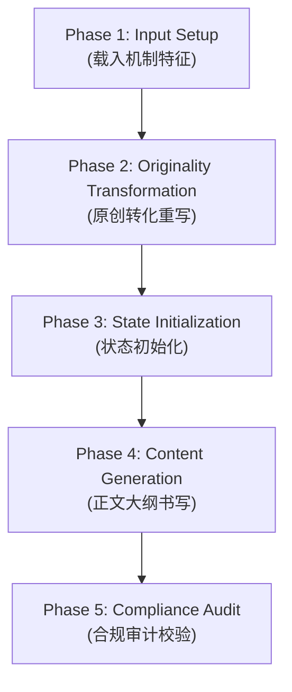

# v1.0 业务执行管道规范书 (Execution Pipeline)

本规范书锁定了 Novel Research Lab v1.0 系统的自动化执行通路，规定了从输入机制到输出正文的 5 个串行管道阶段（Phases）及控制流逻辑。

---

## 1. 执行管道阶段划分 (Pipeline Phases)

### 1.1 Phase 1: 机制载入阶段 (Input Setup)
*   **动作**：读取验收所需的 `input_mechanisms.json`，载入 3-5 个需要模拟的抽象叙事机制（如：“三年之约备战 Deadline”、“敛气易容的双轨身份”等）。
*   **主体**：Coordinator / Reader Agent。

### 1.2 Phase 2: 原创性转化阶段 (Originality Transformation)
*   **动作**：匹配并调用 `OriginalityTransformer` 技能，根据机制类别执行命名重写和世界观因果的重新归因，输出脱敏后的原创 `Book DNA` 和原创 `Narrative DNA`。
*   **主体**：Transformer Agent。

### 1.3 Phase 3: 状态初始化阶段 (State Initialization)
*   **动作**：根据原创 DNA 中声明的规则，自动实例化初始的 `State Ledger` 状态：
    *   设置 `true_profile` 初始修为与 `public_mask` 掩码修为。
    *   将包含 backlash（反噬限制）的原创法宝道具注册进 `inventory`。
    *   初始化各势力声望列表。
*   **主体**：Coordinator / Writer Agent。

### 1.4 Phase 4: 正文大纲生成阶段 (Content Generation)
*   **动作**：
    1.  生成原创大纲故事线，包含每个节点的情绪抑扬状态（`tension`）与避战选项。
    2.  大纲通过 `DoubleTrackLedgerValidator` 校验。
    3.  Writer Agent 消费大纲，生成 3000-5000 字的第一章原创正文，正文中必须表现主角修为被隐匿和突发危险时战略撤退（跑路）的情节。
*   **主体**：Writer Agent。

### 1.5 Phase 5: 合规与原创性审计阶段 (Compliance Audit)
*   **动作**：
    1.  扫描生成的正文和转化后的大纲，进行字面量查重与敏感原著词汇匹配。
    2.  验证是否包含原著标志性特征组合的违规侵入。
    3.  核对正文中法宝反噬等逻辑一致性。
    4.  生成符合 JSON 格式的审计报告，写入 `demo_run/output_audit_report.json`。
*   **主体**：Auditor Agent。

---

## 2. 管道分支与容错逻辑 (Fallback Control)
*   **审计挂科 Fallback**：若 Phase 5 审计报告中的 `compliance_status` 判定为 `failed`，系统必须自动阻断，不予交付第一章，并将数据退回 Phase 2。系统会调整 Naming Guidelines 规避词，重新运行原创转化和正文书写。
*   **一致性报错 Fallback**：若 `consistency_status` 检测到修为等级错乱，直接抛出编译异常，退回 Phase 4 重写正文。
