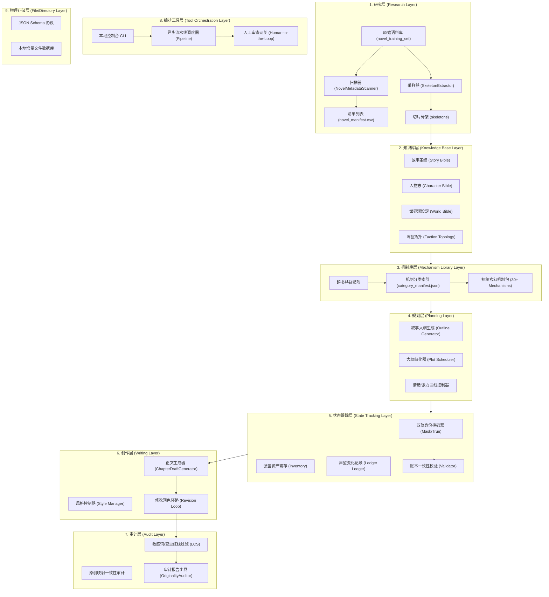

# 03：Novel Research Lab 系统重构工程蓝图 (Revised Engineering Blueprint)

*   **当前阶段**：`Phase 0C`
*   **架构定义**：工业级多智能体小说创作与研究框架蓝图

为了实现小说研究与创作的工程级落地，本蓝图确立了系统的 9 层重构架构设计，支持从底层语料分析到上层正文创作的多智能体编排。

---

## 1. 系统架构分层蓝图 (Mermaid Map)

---

## 2. 架构层级深度定义

### 1. 研究层 (Research Layer)
*   **职能**：实现生文本的结构化转化。包含元数据扫描模块与骨架切片工具，负责将数十万字的小说切片输出为便于大模型消费的骨架。

### 2. 知识库层 (Knowledge Base Layer)
*   **职能**：持久化设定存储。通过 Book DNA 驱动，分类保存故事圣经（Story）、人物属性关系（Character）、地理物理法则（World）与势力声望地图（Faction）。

### 3. 机制库层 (Mechanism Library Layer)
*   **职能**：叙事资产中心。承载跨书特征矩阵与脱敏后的通用抽象机制定义（30个以上），向大纲生成提供规则包。

### 4. 规划层 (Planning Layer)
*   **职能**：大纲与细纲生成。根据输入的抽象机制配方，规划小说总情绪起伏（Tension）与每个情节节点（Narrative DNA）的避战/逃跑属性。

### 5. 状态跟踪层 (State Tracking Layer)
*   **职能**：内存一致性控制。由 State Ledger 驱动，维护 True Profile、Public Mask、Inventory 三个属性表，确保法宝消耗与战力境界变化完全匹配。

### 6. 创作层 (Writing Layer)
*   **职能**：正文生成。由 `ChapterDraftGenerator` 和风格修饰模块驱动，结合上层规划和状态，产出 3000-5000 字正文，通过 Draft-Critic 环路多轮修改。

### 7. 审计层 (Audit Layer)
*   **职能**：合规性判定。由 `OriginalityAuditor` 驱动，比对敏感词库、禁止相似列表，进行 LCS 相似度预警计算，生成标准的审计报告。

### 8. 编排工具层 (Tool Orchestration Layer)
*   **职能**：进程驱动与通信总线。提供命令行 CLI 接口，调度 reader $\rightarrow$ writer 进程，并在重要状态转换点挂起，等待人工签字审批。

### 9. 物理存储层 (File/Directory Layer)
*   **职能**：底层物理读写。定义 `phase0B/03_json_schema_v1/` 等标准接口目录，并使用 Git 对生成的 JSON 数据资产做版本追踪。
